---
lab:
  title: Develop a managed AI agent with Claude
  description: Use the Claude Platform to define a managed agent, and then build a client app in Visual Studio Code that chats with it.
  level: 200
  duration: 40 minutes
  islab: false
---

# Develop a managed AI agent with Claude

This exercise should take approximately **40** minutes to complete.

> **Note**: Claude Platform and the Claude models are subject to continual development. This reflects the fast-moving nature of artificial intelligence technology. Some elements of your user experience may differ from the descriptions in this exercise - in particular, Managed Agents is a beta feature, and the layout of its portal pages may change.

In this exercise, you'll build the same computing history expert agent as in the *Develop your first AI agent with Claude* exercise - but this time as a *managed agent*. Instead of writing an agent loop in your own code, you'll define the agent in the Claude Console and let Anthropic host it and run the loop. Then you'll write a small Python client app that starts a session with your agent and chats with it.

## Before you start

Before you start this lab, complete the lab [Get ready for Claude API development](00-get-ready-for-claude-api-development.html). It creates your Claude Console account and installs the tools this lab uses: Visual Studio Code, Git, GitHub, and Python. If you haven't done that yet, complete it first.

## Understand managed agents

When you build an agent with the Messages API, your code owns the agent loop, the conversation history, and the place where tools run. With **Managed Agents**, those responsibilities move to the platform:

- An **agent** is a saved, versioned definition of a model, instructions (system prompt), and tools.
- An **environment** is a template for the cloud container in which the agent's tools run.
- A **session** is a running instance of an agent in an environment. The session keeps the conversation state, and runs the agent loop on Anthropic's infrastructure.
- Your client app sends **events** (such as a user message) to the session, and receives a stream of events (such as the agent's response) back.

> **Note**: Using the Claude API requires an Anthropic Console account with API credits. Usage in this exercise is light, but if your account has no credits, you'll be prompted to add some before you can run sessions.

## Create a managed agent in the Claude Console

1. In a web browser, open the [Claude Console](https://platform.claude.com){:target="_blank"} at `https://platform.claude.com`, and sign in. If prompted, complete any setup steps - including adding credits to your account.

    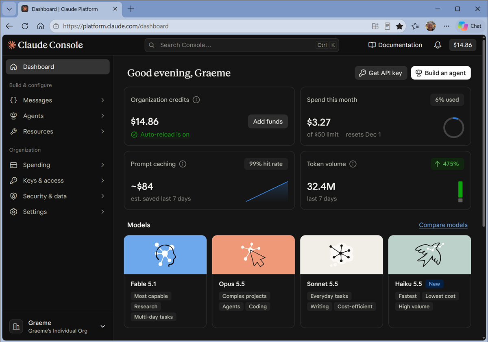

### Create the agent

1. In the navigation menu, in the **Agents** section, open the **Create** page.

    A list of agent templates is shown.

    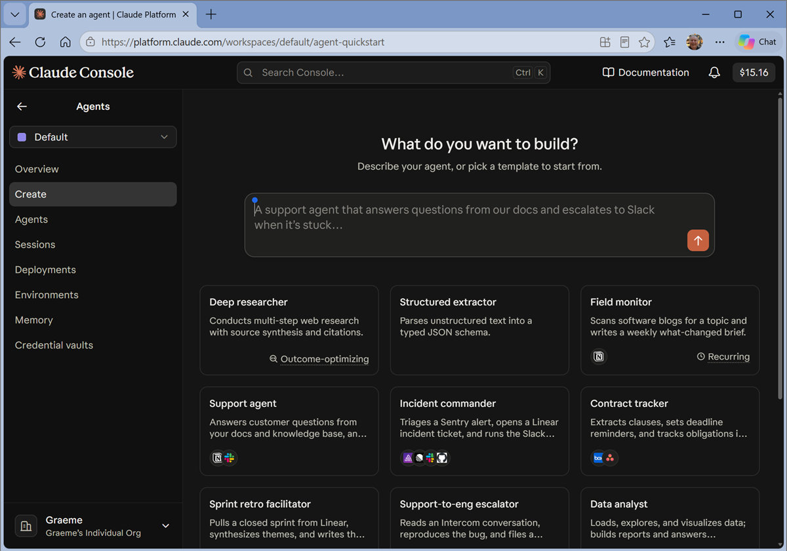

1. Under the list of templates, select **start from a blank agent**. This starts a multi-step wizard to help you walk through the steps of creating a managed agent.
1. In the first step, enter the following description for the agent:

    ```
    A computing history agent that helps users with questions about key people, events, and technologies in the history of computing.
    ```

1. Review the agent configuration that is created, and then go ahead and create the agent.
1. Create a new environment for tha agent, with unrestricted web search.
1. Start a test session and test the agent with a suitable question, such as `Who was Grace Hopper, and why was her work on compilers so important?`.

    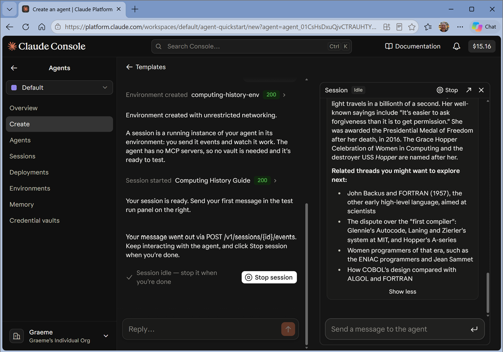

1. Stop the test session and specify that you want to call the agent from an application. Then  exit the agent creation wizard. Your completed agent is opened in its own page.

    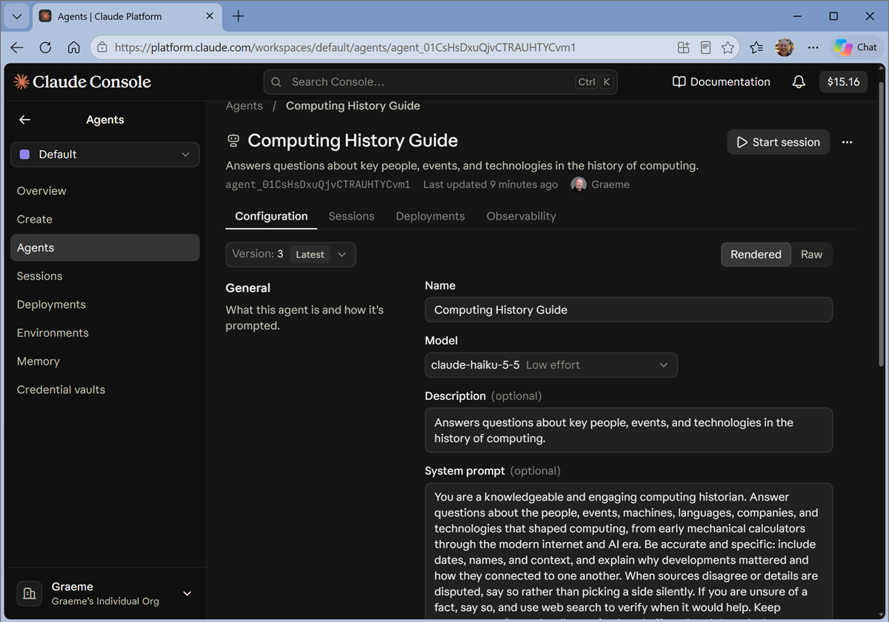

### Configure the agent

1. In the page for your agent, select the model **Claude Haiku 5.5** (`claude-haiku-5-5`) and review the **System prompt**, modifying it if desired. As a minimum, it should provide guidance to the agent similar to this:

   ```
   You are an expert in the history of computing and AI. You only answer questions about significant people and events in the development of computing, and about notable vintage computers. Do not engage in conversations on any topic that is unrelated to computing history.
   ```

1. In the agent's tools configuration, set the **web_fetch** and **web_search** tool permissions to **Always allow**, and set the **Always deny** permission for all the other built-in tools (such as bash, file read/write/edit, and web fetch) - your agent only needs to search and retrieve information from the web.

    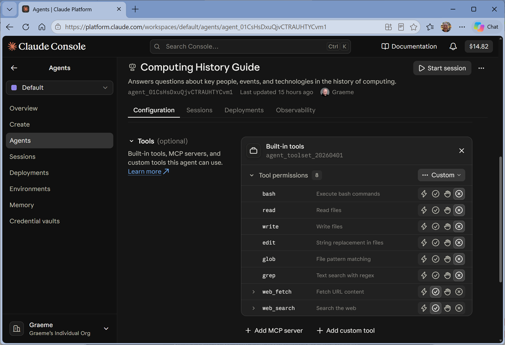

    > **Note**: The agent toolset includes *server-hosted* tools such as bash and file operations that run in the session's container. You've turned off the ones this agent doesn't need - it's good practice to give an agent only the tools it needs.

1. Save a new version of the agent with your changes.
1. Start a new session named `Test run` in the environment that was created for by the wizard, and test the updated agent with a suitable prompt (such as `Tell me about Alan Turing.`).

    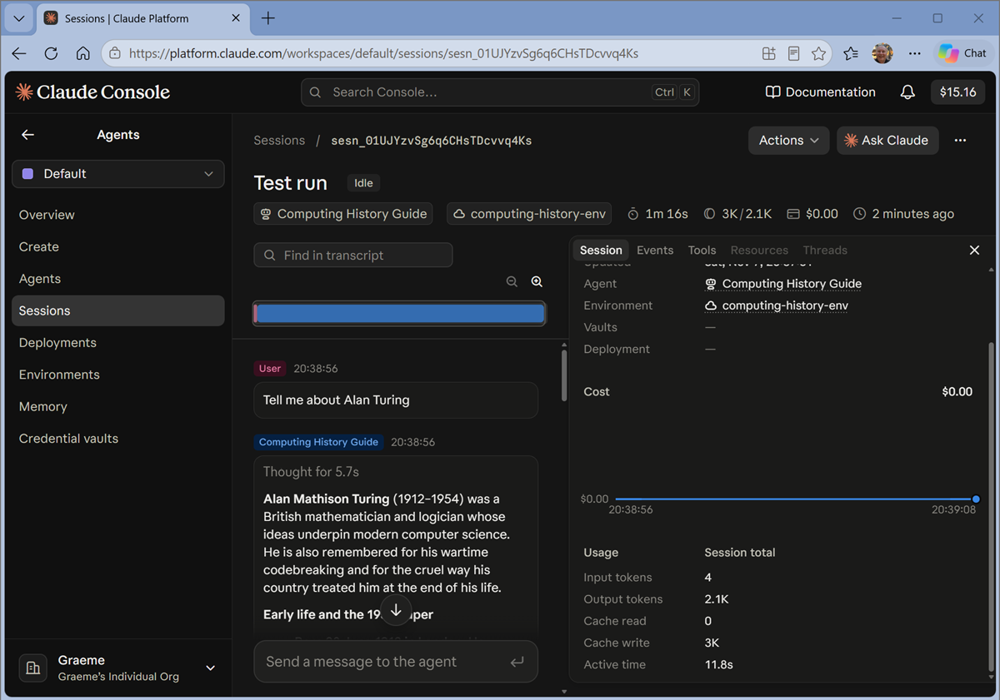

    > **Tip**: The session transcript shows every event in the session - including each tool call and its result, along with token usage. It's a useful way to see what the agent did and why.

### View agents and environments

1. View the **Agents** page, where your agent (and any others you've created) is listed. Note the **agent ID** (it looks like `agent_...`). You'll need this later.

1. View the **Environments** page and find the cloud environment created for your agent.

    > **Note**: Unrestricted networking you configured in the wizard is fine for this learning exercise because the agent has no access to sensitive files or secrets. For a production agent, use *limited* networking and list only the hosts the agent needs.

1. Note the **environment ID** (it looks like `env_...`). You'll also need this later.

### Create an API key

To call your agent from code, you need an API key.

1. In the Claude Console, in the navigation menu, return to the top-level **Dashboard** page and select **Get API key**.

    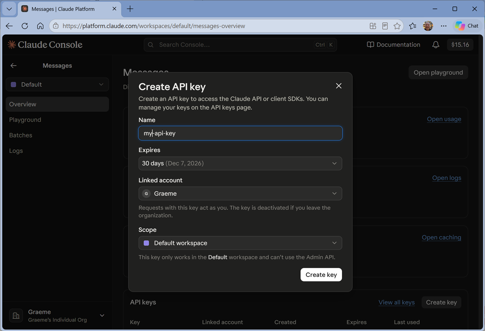

1. Create a new key named `computing-historian-agent-client`, and copy its value. Store it somewhere safe temporarily - you won't be able to view it again after you close the dialog.

## Create a client app for the agent

Now you'll write Python code that starts a session with your managed agent and uses it in a simple web-based chat application.

### Configure a client application in Visual Studio Code

A partially completed client application has been provided. You'll complete this app and test it.

1. Start Visual Studio Code.

    > **Tip**: If you're new to Visual Studio Code, you can refer to the [documentation](https://code.visualstudio.com/Docs){:target="_blank"} at `https://code.visualstudio.com/Docs` for help.

1. If you haven't already cloned the repo, open the command palette (*Ctrl+Shift+P* or on the **View** menu, select **Command Palette**) and enter the `Git:clone` command to clone the `https://github.com/GraemeMalcolm/claude-labs` repo to a local folder (it doesn't matter which one). Then open the folder when prompted.

    The folder may open in **Restricted mode**. If so, select the mode and trust the authors to allow full functionality.

    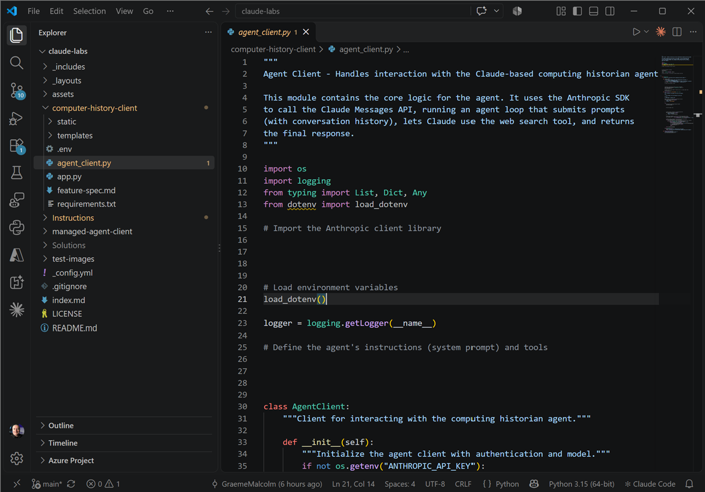

1. In the Activity bar on the left edge, view the **Extensions** pane; and if it is not already installed, search for and install the **Python** extension.
1. In the **Command Palette**, use the command `python:select interpreter` to create a new **Venv** environment based on your Python 3.1x installation (or select the one you created previously).

    > **Tip**: You can choose to install the workspace dependencies in the *requirements.txt* file as you create the environment. Don't worry if you accidentally skip this though; we'll do it in a later step anyway.

1. In the **Explorer** pane, navigate to the folder containing the application code files at **/managed-agent-client**. The application files include:
    - **.env** (the application configuration file)
    - **agent_client.py** (the code file for the Python code that connects to your agent)
    - **app.py** (the main code file for a Python Flask-based web application)
    - **requirements.txt** (the Python package dependencies that need to be installed)
1. In the **Explorer** pane, right-click the **agent_client.py** file, and select **Open in integrated terminal**.

    > **Tip**: Opening the terminal in Visual Studio Code should automatically activate the Python environment after a few seconds. If you're using a PowerShell terminal, you may need to enable running scripts on your system (see [Set-ExecutionPolicy](https://learn.microsoft.com/powershell/module/microsoft.powershell.security/set-executionpolicy){:target="_blank"}). If for any reason the Python environment is not activated automatically, you can use [this query](https://www.bing.com/search?q=%22How%20do%20I%20activate%20a%20Python%20venv%22){:target="_blank"} to search for information on how to activate it in your environment.

1. Ensure that the terminal is open in the **/managed-agent-client** folder with the prefix **(.venv)** to indicate that the Python environment is active.

    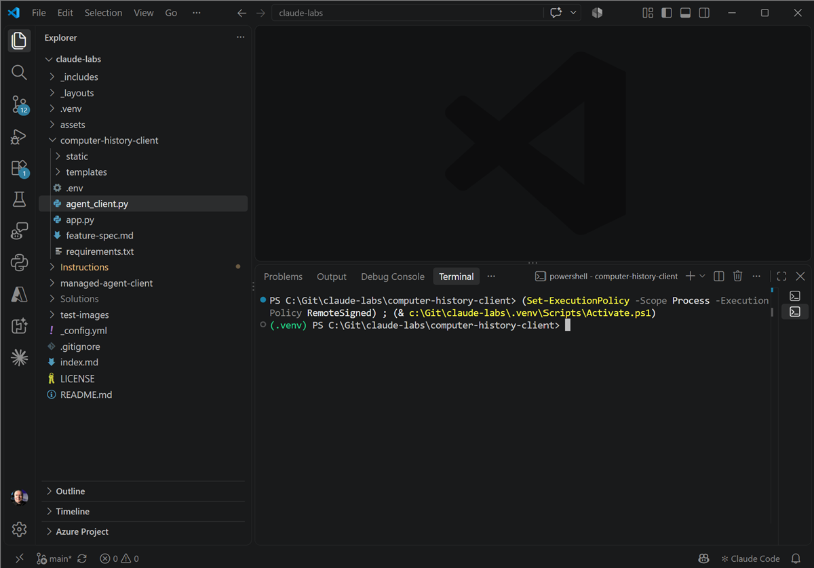

    > **Tip**: You can resize the terminal pane.

1. Install the required Python packages by running the following command:

   ```
   pip install -r requirements.txt
   ```

1. In the **Explorer** pane, in the **/managed-agent-client** folder, select the **.env** file to open it. Then replace the placeholder values:
    - *your_api_key* with the API key you created in the Claude Console.
    - *your_agent_id* with the ID of your `computing-historian` agent.
    - *your_environment_id* with the ID of your `computing-historian-env` environment.

    > **Important**: An API key is a secret. Never commit it to source control or share it. In this exercise it's stored in a local *.env* file that your code loads at runtime - don't commit your edited *.env* file if you push changes to a repo.

1. Save the updated **.env** file.

### Add code to connect to the agent

Notice that this client doesn't contain the model name, the system prompt, or the tool definitions - they're all part of the agent you defined in the Console. The client only needs to start a session and exchange events with it.

1. In the **Explorer** pane, in the **/managed-agent-client** folder, select the **agent_client.py** file (<u>not</u> *app.py*) to open it.

    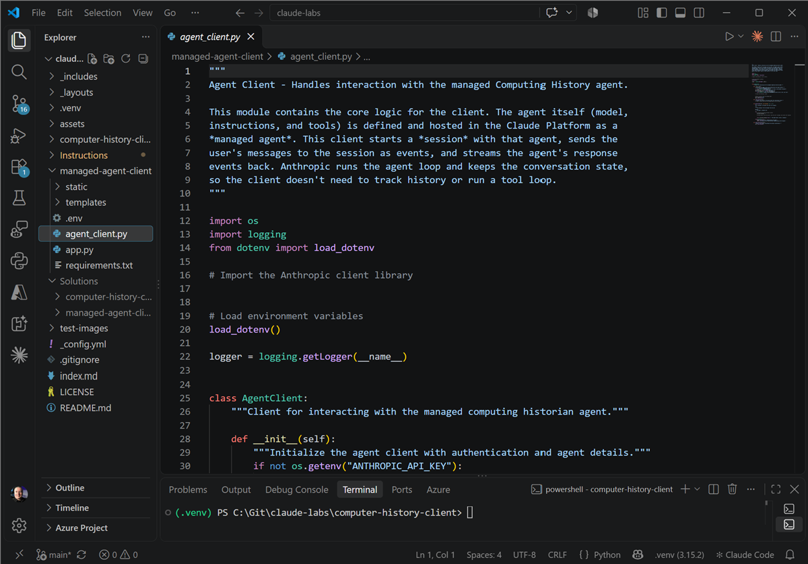

    > **Tip**: You can resize the terminal pane.

1. Review the existing code. You will add code that uses the Anthropic SDK to work with your agent.

    > **Tip**: As you add code to the code file, be sure to maintain the correct indentation.

1. Find the comment **Import the Anthropic client library**, and add the following code to import the SDK:

   ```python
   # Import the Anthropic client library
   from anthropic import Anthropic
   ```

1. In the **AgentClient** class, in the **\_\_init\_\_** function, note that code has been provided to load the API key, agent ID, and environment ID from the configuration file. Then find the comment **Create the Anthropic client** and add the following code:

   ```python
   # Create the Anthropic client
   self.client = Anthropic()
   ```

    The client automatically reads the **ANTHROPIC_API_KEY** environment variable (which was loaded from your *.env* file).

1. In the **\_start_session** function, find the comment **Create a session that uses the managed agent and environment** and add the following code:

   ```python
   # Create a session that uses the managed agent and environment
   session = self.client.beta.sessions.create(
        agent=self.agent_id,
        environment_id=self.environment_id,
   )
   self.session_id = session.id
   ```

    The session is the running instance of your agent. Because the session stores the conversation, the client app doesn't need to keep a history of messages - it just needs to remember the session ID. Passing the agent ID as a string uses the latest version of the agent.

1. In the **send_message** function, find the comment **Stream events from the session, send the user's message, and collect the response** and add the following code:

   ```python
   # Stream events from the session, send the user's message, and collect the response
   with self.client.beta.sessions.events.stream(session_id=self.session_id) as stream:
        # Send the user's message to the session as an event
        self.client.beta.sessions.events.send(
            session_id=self.session_id,
            events=[{
                "type": "user.message",
                "content": [{"type": "text", "text": user_message}],
            }],
        )

        # Process the events the agent sends back
        for event in stream:
            if event.type == "agent.message":
                # The agent's reply is made up of text blocks
                for block in event.content:
                    if block.type == "text":
                        assistant_message += block.text
            elif event.type == "session.status_idle":
                if event.stop_reason.type == "requires_action":
                    # The agent is waiting for a tool approval that this app doesn't provide
                    assistant_message += "\n\nThe agent needs approval to use a tool. Check the agent's tool permission settings."
                # The agent has finished its turn
                break
            elif event.type == "session.status_terminated":
                assistant_message += "\n\nThe session ended unexpectedly."
                break
   ```

    This code is the heart of the client. The stream is opened *before* the message is sent, so that no events are missed. The agent loop - deciding whether to search the web, running the searches, and composing the answer - all happens on the platform. Your code just watches the stream of events: **agent.message** events contain the response text, and a **session.status_idle** event signals that the agent has finished and is waiting for the next message.

    > **Tip**: The stream can also contain events for tool use (such as **agent.tool_use**), which you could use to show users what the agent is doing. For *custom* tools that run in <u>your</u> code, the agent sends an **agent.custom_tool_use** event, and your code responds with a **user.custom_tool_result** event.

1. Read through the rest of the code, noting how **reset_conversation** starts a new session to clear the conversation.
1. Save the updated **agent_client.py** file.

### Run the client application

Now you're ready to test the app.

1. In the terminal, enter the following command to run the application:

   ```powershell
   python app.py
   ```

1. When the Flask application starts, open your browser and navigate to the URL where it is running - for example, [http://127.0.0.1:5000](http://127.0.0.1:5000) (`http://127.0.0.1:5000`).

    > **Tip**: If the app displays an error that the agent client isn't initialized, check that your API key, agent ID, and environment ID are correctly set in the *.env* file, and that you saved the file.

    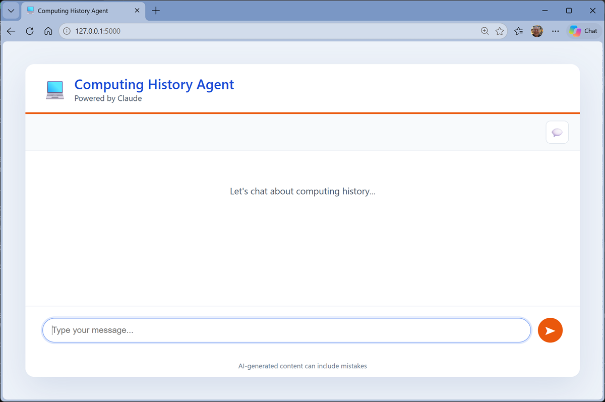

1. Enter a prompt, such as `What was ENIAC?` and view the response.

    The first response may take a little longer, as the session's container is provisioned.

1. Follow up with a second prompt, such as `How does it compare with COLOSSUS?`
1. Try an off-topic prompt, like `What's a good recipe for pancakes?`, to verify that the agent follows its instructions.
1. Try more prompts, like `Find the latest news for vintage computer enthusiasts.`
1. Select the **reset** button in the app to start a new conversation, and then ask `How does it compare with COLOSSUS?` again. Because this is a new session, the agent doesn't know what "it" refers to.
1. When you've finished testing the app, close the browser, and in Visual Studio Code, enter **CTRL+C** in the terminal pane, to stop the local web server.

### View the sessions in the Console

1. Return to the Claude Console and in the **Agents** section, on the **Sessions** page, view the sessions for your agent.
1. Open the sessions created by your client app, and review the transcript of events - including the user messages, agent responses, and web search tool calls.

    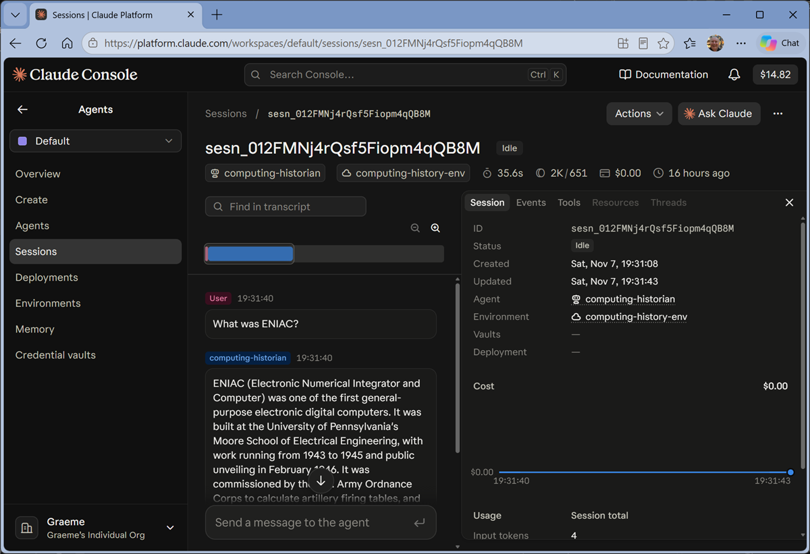

### Update the agent

Because the agent is defined in the platform, you can change its behavior without changing your client code.

1. In the Console, in the **Agents** section, on the **Agents** page, open your computing historian agent and add the following sentence to the end of the system prompt:

   ```
   Always end your answers with a fun fact related to the topic.
   ```

1. Save the changesto create a new version of the agent.
1. In Visual Studio Code, re-run the app (`python app.py`), open it in the browser, and ask `Who invented the transistor?`

    The new session uses the latest version of the agent, so the response should include a fun fact - and you didn't change a line of client code.

1. When you've finished testing the app, close the browser, and in Visual Studio Code, enter **CTRL+C** in the terminal pane, to stop the local web server.

## Summary

In this exercise, you defined an AI agent as a managed agent in the Claude Console - with a model, instructions, a web search tool, and a cloud environment - and then built a Python client app that starts sessions with the agent and streams its responses. You saw how a managed agent differs from an agent you implement yourself: the platform hosts the agent, runs the agent loop, and keeps the conversation state.

## Clean up

If you no longer need the resources you created for this exercise, you can delete the API key in the **API keys** page of the Claude Console, so that it can't be used again. You can also archive the agent and the environment in the Console - note that archiving can't be undone.
