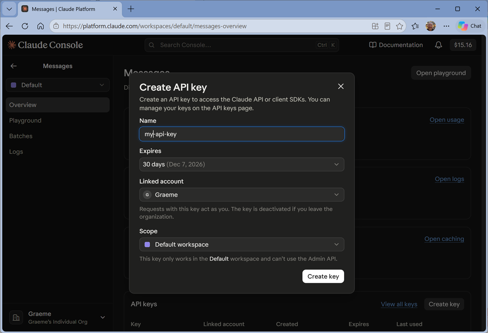
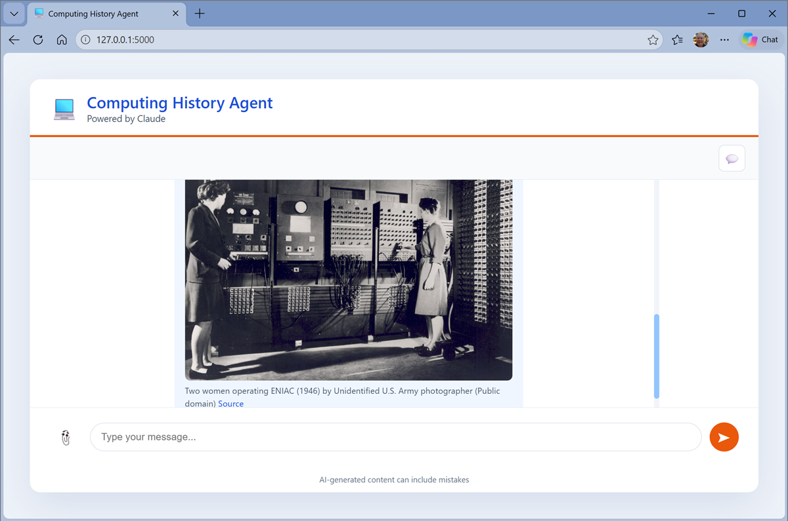

---
lab:
  title: Extend an AI agent with tools
  description: Combine Claude's built-in web search tool with a custom tool function, so that your agent can find, download, and display openly licensed images.
  level: 200
  duration: 40 minutes
  islab: false
---

# Extend an AI agent with tools

This exercise should take approximately **40** minutes to complete.

> **Note**: Claude Platform, Claude Code, and the Claude models are subject to continual development. This reflects the fast-moving nature of artificial intelligence technology. Some elements of your user experience may differ from the descriptions in this exercise!

In this exercise, you'll extend the computing history agent that you built in the *Develop your first AI agent with Claude* exercise. Your agent already uses Claude's built-in *web search* tool to find information. Now you'll add a *custom tool* - a function in your own code that Claude can ask your app to run. When a user asks to see a picture of a historic computer, hardware component, or person, the agent will search the web for an openly licensed image, call your tool to download it to a **/downloads** folder, and the app will display the image in the chat.

## Before you start

Before you start this lab, complete the lab [Get ready for Claude API development](00-get-ready-for-claude-api-development.html). It creates your Claude Console account and installs the tools this lab uses: Visual Studio Code, Git, GitHub, and Python.

This lab continues from the lab [Develop your first AI agent with Claude](01-create-first-claude-agent.html). We recommend that you complete that lab first, but you don't have to - the starter files for this lab contain the finished code from that lab.

## Understand tools

A *tool* gives a model a way to get information or take an action that it can't manage on its own. You describe each tool to Claude in your request, and Claude decides when to use it. There are two kinds of tool:

- **Server-side tools**, such as *web search*, are built in to the Claude Platform. Anthropic runs them for you: Claude uses the tool and incorporates the results, all within a single API call. You only need to declare the tool.
- **Client-side (custom) tools** are functions in <u>your</u> code. You declare each tool with a *name*, a *description*, and an *input schema* (a JSON schema for the tool's parameters). Claude can't run your function itself; instead, when it needs the tool, it stops with the stop reason **tool_use** and returns a **tool_use** content block containing the tool's name and the input values. Your code runs the function and sends the output back to Claude in a **tool_result** content block. Claude then carries on - perhaps using more tools - until it has everything it needs to respond.

In this exercise, you'll combine both kinds of tool. Claude will use the built-in web search tool to find a suitable image, and then call your custom **download_image** tool to save it.

> **Tip**: Downloading a file from the web is a good fit for a custom tool. The file needs to end up on <u>your</u> computer, so that your app can display it - and a server-side tool can't save files there.

## Configure the client application

A client application containing the code from the end of the previous lab has been provided. You'll extend this app to add the custom tool.

### Open the client app in Visual Studio Code

1. Start Visual Studio Code.
1. If you have already cloned the repo for these labs, open the local folder in Visual Studio Code. If not, open the command palette (*Ctrl+Shift+P* or on the **View** menu, select **Command Palette**) and enter the `Git:clone` command to clone the `https://github.com/GraemeMalcolm/claude-labs` repo to a local folder (it doesn't matter which one); and after the clone operation is complete, open the folder when prompted.

    > **Tip**: If you cloned the repo before this lab was added, open the command palette and use the `Git: Pull` command to get the latest files.

    The folder may open in **Restricted mode**. If so, select the mode and trust the authors to allow full functionality.

1. In the Activity bar on the left edge, view the **Extensions** pane; and if it is not already installed, search for and install the **Python** extension.
1. In the **Command Palette**, use the command `python:select interpreter` to create a new **Venv** environment based on your Python 3.1x installation (or select the one you created previously).

    > **Tip**: You can choose to install the workspace dependencies in the *requirements.txt* file as you create the environment. Don't worry if you accidentally skip this though; we'll do it in a later step anyway.

1. In the Activity bar, switch back to the **Explorer** pane, and navigate to the folder containing the application code files at **/computer-history-tools-client**. The application files include:
    - **.env** (the application configuration file)
    - **agent_client.py** (the code file for the Python code that implements your agent)
    - **app.py** (the main code file for a Python Flask-based web application)
    - **requirements.txt** (the Python package dependencies that need to be installed)
    - **/static** and **/templates** (the files for the app's web page)
1. In the **Explorer** pane, right-click the **agent_client.py** file, and select **Open in integrated terminal**.

    > **Tip**: Opening the terminal in Visual Studio Code should automatically activate the Python environment after a few seconds. If you're using a PowerShell terminal, you may need to enable running scripts on your system (see [Set-ExecutionPolicy](https://learn.microsoft.com/powershell/module/microsoft.powershell.security/set-executionpolicy){:target="_blank"}). If for any reason the Python environment is not activated automatically, you can use [this query](https://www.bing.com/search?q=%22How%20do%20I%20activate%20a%20Python%20venv%22){:target="_blank"} to search for information on how to activate it in your environment.

1. Ensure that the terminal is open in the **/computer-history-tools-client** folder with the prefix **(.venv)** to indicate that the Python environment is active.
1. Install the required Python packages by running the following command:

   ```
   pip install -r requirements.txt
   ```

### Configure your API key

1. If you still have the API key that you created in the previous lab, you can use it in this lab. Otherwise, in a web browser, open the [Claude Console](https://platform.claude.com){:target="_blank"} at `https://platform.claude.com`, and on the **Dashboard** page, select **Get API key** to create a new key with a suitable name.

    

    Copy the key's value and store it somewhere safe temporarily - you won't be able to view it again after you close the dialog.

1. In Visual Studio Code, in the **Explorer** pane, in the **/computer-history-tools-client** folder, select the **.env** file to open it. Then replace *your_api_key* with your API key.

    > **Important**: An API key is a secret. Never commit it to source control or share it. Don't commit your edited *.env* file if you push changes to a repo.

1. Save the updated **.env** file.

## Define a custom tool

Now you'll tell Claude about your custom tool, and update the agent's instructions so that it knows when to use it.

1. In the **Explorer** pane, in the **/computer-history-tools-client** folder, select the **agent_client.py** file to open it.
1. Review the code near the top of the file. It's the code from the previous lab, with some additions that have been provided for you:
    - **DOWNLOADS_FOLDER**, the **/downloads** folder in the app, where images will be saved.
    - **IMAGE_TYPES** and **MAX_IMAGE_BYTES**, which limit downloads to common image file types of up to 5 MB.
    - **USER_AGENT**, which identifies the app to the web sites it downloads from. Many image sites, including Wikimedia Commons, reject requests from clients that don't identify themselves.
    - A **fetch_image** helper function, which downloads an image from a URL and returns its data and media type. If the URL is for a web page rather than an image file (for example, an image's page on Wikimedia Commons), the function finds the page's main image and downloads that instead.

    > **Note**: Claude also has a built-in *web fetch* tool, which can read a web page - so you could have Claude open each image's page to find the URL of the image file. However, web fetch runs on Anthropic's servers and returns the page's content to Claude, not to your app; and some sites limit or block automated access, so it doesn't always succeed. Because your app needs to download the image anyway, it's simpler and more reliable for the app to find the image file itself.

1. Find the comment **Define the agent's instructions (system prompt) and tools**, and replace the existing **SYSTEM_PROMPT** and **TOOLS** definitions under it with the following code:

    > **Tip**: As you add code to the code file, be sure to maintain the correct indentation.

   ```python
   # Define the agent's instructions (system prompt) and tools
   SYSTEM_PROMPT = (
       "You are an expert in the history of computing and AI. "
       "You only answer questions about significant people and events in the development "
       "of computing, and about notable vintage computers. "
       "Do not engage in conversations on any topic that is unrelated to computing history. "
       "When the user asks to see an image of a historic computer, hardware component, or person, "
       "use web search to find a relevant image that is in the public domain or released under a "
       "Creative Commons license (Wikimedia Commons is a good source). "
       "Then use the download_image tool to save the image for the user. "
       "Never download an image unless the search results show that its license permits reuse. "
       "After downloading an image, briefly describe what it shows, and credit its author and license."
   )

   TOOLS = [
       # Built-in (server-side) tool: Anthropic runs this for you
       {"type": "web_search_20260209", "name": "web_search", "max_uses": 5},

       # Custom (client-side) tool: your code runs this when Claude asks it to
       {
           "name": "download_image",
           "description": (
               "Downloads an openly licensed image from the web and saves it in the app's downloads "
               "folder, so that it can be displayed to the user. Only use this tool for images that are "
               "in the public domain or released under a Creative Commons license. Images must be JPEG, "
               "PNG, GIF, or WebP files of up to 5 MB. Returns the saved file's details as JSON, or an "
               "error message if the image can't be downloaded."
           ),
           "input_schema": {
               "type": "object",
               "properties": {
                   "image_url": {
                       "type": "string",
                       "description": (
                           "The URL of the image's web page (for example, a Wikimedia Commons file page "
                           "such as https://commons.wikimedia.org/wiki/File:Example.jpg), or the URL of the image file."
                       )
                   },
                   "title": {
                       "type": "string",
                       "description": "A short title describing the image (for example, 'Altair 8800 computer')."
                   },
                   "author": {
                       "type": "string",
                       "description": "The author or creator of the image, as stated on its source page."
                   },
                   "license": {
                       "type": "string",
                       "description": "The image's license (for example, 'CC BY-SA 4.0' or 'Public domain')."
                   },
                   "source_page_url": {
                       "type": "string",
                       "description": "The URL of the web page where the image and its license are described."
                   }
               },
               "required": ["image_url", "title", "author", "license", "source_page_url"]
           }
       }
   ]
   ```

    Review the code, and note the following:
    - The system prompt now tells Claude how to handle requests for images, and that it must only download images whose license permits reuse. Claude uses the web search tool to find the image and its license, and your custom tool to save it.
    - The web search tool is declared with only a **type** and a **name**, because Anthropic implements it.
    - The **download_image** tool has no **type**. Instead, it has a **description** that tells Claude what the tool does and when to use it, and an **input_schema** that defines its parameters. Claude reads these to decide when to call the tool, and what values to pass. Clear descriptions are the most important part of a tool definition!
    - Asking Claude for the image's **author** and **license** as tool inputs means that your app gets the information it needs to credit the image correctly. Creative Commons licenses usually require you to credit the author.

## Implement the custom tool function

Next, you'll write the Python function that runs when Claude calls the **download_image** tool.

1. Find the comment **Implement the custom tool function**, and add the following code under it:

   ```python
   # Implement the custom tool function
   def download_image(image_url: str, title: str, author: str, license: str, source_page_url: str) -> Dict[str, str]:
       """Download an image, save it in the downloads folder, and return its details."""
       data, media_type = fetch_image(image_url)

       # Create a safe, unique file name from the title (never trust a file name from the web)
       slug = re.sub(r"[^a-z0-9]+", "-", title.lower()).strip("-")[:40] or "image"
       filename = f"{slug}-{uuid.uuid4().hex[:8]}{IMAGE_TYPES[media_type]}"

       DOWNLOADS_FOLDER.mkdir(exist_ok=True)
       (DOWNLOADS_FOLDER / filename).write_bytes(data)
       logger.info("Downloaded %s to %s", image_url, filename)

       return {
           "filename": filename,
           "title": title,
           "author": author,
           "license": license,
           "source_page_url": source_page_url,
       }
   ```

    The function's parameters match the properties in the tool's input schema, so the input that Claude provides can be passed straight to the function. The function downloads the image, saves it in the **/downloads** folder, and returns the details of the saved file.

    > **Note**: Treat the input to a custom tool with the same care as any other untrusted input - it's generated by a model, based on content from the web. This function never uses a file name from the web; it builds its own file name from the title and a random ID, so a tool call can't write a file outside the **/downloads** folder. The **fetch_image** helper also only accepts *http* and *https* URLs, and limits the size of the download. In a production app, you might also restrict downloads to a list of trusted sites.

## Handle tool use in the agent loop

In the previous lab, the agent loop only had to handle server-side tools. Now it needs to recognize when Claude wants to use your custom tool, run the tool, and send the result back to Claude.

1. In the **AgentClient** class, in the **\_\_init\_\_** function, find the line `self.max_turns = 5` and change it to:

   ```python
   self.max_turns = 10
   ```

    Using a custom tool adds at least one extra call to Claude (to send the tool's result back), so the agent loop needs a few more turns.

1. Under the comment **Track the images downloaded while responding to the latest message**, add the following code:

   ```python
   # Track the images downloaded while responding to the latest message
   self.downloaded_images: List[Dict[str, str]] = []
   ```

    The app will use this list to find out which images to display with the agent's response.

1. Find the comment **Run a custom tool that Claude requested** (which is just before the **send_message** function), and add the following code under it, at the same level of indentation as the comment:

   ```python
   # Run a custom tool that Claude requested
   def run_tool(self, tool_use) -> Dict[str, Any]:
       """Run a custom tool that Claude requested, and return a tool_result content block."""
       try:
           if tool_use.name == "download_image":
               image = download_image(**tool_use.input)
               self.downloaded_images.append(image)
               result = json.dumps(image)
           else:
               raise ValueError(f"Unknown tool: {tool_use.name}")

           return {"type": "tool_result", "tool_use_id": tool_use.id, "content": result}

       except Exception as e:
           # Tell Claude the tool failed, so it can try something else (such as a different image)
           logger.warning("Tool %s failed: %s", tool_use.name, e)
           return {
               "type": "tool_result",
               "tool_use_id": tool_use.id,
               "content": f"Error: {e}",
               "is_error": True,
           }
   ```

    This function takes a **tool_use** content block from Claude's response, and calls the function for the tool it names - passing the input values that Claude generated as arguments. It returns a **tool_result** content block containing the tool's output. Note that:
    - The **tool_use_id** links the result to the tool call that requested it.
    - If the tool fails (for example, if the download is blocked or the image is too large), the function doesn't raise an exception. Instead, it returns the error message with **is_error** set to *True*. Claude reads the error and can recover - for example, by trying a different image, or by explaining the problem to the user.

1. In the **send_message** function, find the comment **Clear the list of images downloaded for the previous message**, and add the following code under it:

   ```python
   # Clear the list of images downloaded for the previous message
   self.downloaded_images = []
   ```

1. In the agent loop, find the comment **If Claude wants to use a custom tool, run it and send the results back** (after the code that handles the **pause_turn** stop reason), and add the following code under it:

   ```python
   # If Claude wants to use a custom tool, run it and send the results back
   if response.stop_reason == "tool_use":
       messages.append({"role": "assistant", "content": response.content})
       tool_results = [
           self.run_tool(block) for block in response.content if block.type == "tool_use"
       ]
       messages.append({"role": "user", "content": tool_results})
       continue
   ```

    This is the heart of client-side tool use. When the stop reason is **tool_use**, the code:
    1. Adds Claude's response to the messages - including its web searches and the **tool_use** blocks - so that Claude can see its own work on the next turn.
    1. Runs each tool that Claude requested. Claude can request more than one tool call in a single response, so the code collects all of the results.
    1. Sends all of the **tool_result** blocks back in a single *user* message, and continues the loop so that Claude can use the results.

    When Claude has finished, the stop reason is **end_turn**, and the loop ends just as it did before.

1. Review the updated **send_message** function to make sure you understand the complete agent loop, and then save the **agent_client.py** file.

## Display downloaded images in the app

The agent can now download images, but the app doesn't display them yet. You'll update the web app to send the details of any downloaded images to the browser, and to serve the image files from the **/downloads** folder.

> **Note**: You don't need to change the app's browser code. The JavaScript code in **/static/script.js** already includes an **appendDownloadedImages** function, which displays any images listed in the response from the web app below the agent's message - with a caption that credits each image's author and license and links to its source page. (The same code was in the app in the previous lab, but it wasn't used, because the agent had no way to download images.)

1. In the **Explorer** pane, in the **/computer-history-tools-client** folder, select the **app.py** file to open it.
1. In the **chat** function, find the comment **Add the details of any images the agent downloaded, with the URL to display each one**, and add the following code under it:

   ```python
   # Add the details of any images the agent downloaded, with the URL to display each one
   images = [
       {**image, 'url': url_for('downloaded_image', filename=image['filename'])}
       for image in agent.downloaded_images
   ]
   ```

1. Modify the **return** statement under the code you just added so that it includes the list of images, like this:

   ```python
   return jsonify({
       'response': response,
       'response_html': response_html,
       'images': images
   })
   ```

1. Find the comment **Serve images from the downloads folder** (after the **chat** function), and add the following code under it:

   ```python
   # Serve images from the downloads folder
   @app.route('/downloads/<path:filename>')
   def downloaded_image(filename):
       """Serve an image from the downloads folder."""
       return send_from_directory(DOWNLOADS_FOLDER, filename)
   ```

    Flask's **send_from_directory** function only serves files from inside the folder you specify, so the route can't be used to read other files on your computer.

1. Save the **app.py** file.

## Run the client application

Now you're ready to test your agent's new tool.

1. In the terminal, enter the following command to run the application:

   ```powershell
   python app.py
   ```

1. When the Flask application starts, open your browser and navigate to the URL where it is running - for example, [http://127.0.0.1:5000](http://127.0.0.1:5000) (`http://127.0.0.1:5000`).

1. Enter the prompt `Show me a picture of ENIAC`, and wait for the response.

    The agent searches the web for a suitable image, downloads it with your tool, and responds with a description of the image and a credit for its author and license. The image is displayed below the response, with a caption that links to its source page.

    

    > **Tip**: Finding and downloading an image takes several steps, so the response may take a little longer than usual. If the agent reports that it couldn't download an image, try again or ask for a different image - web sites sometimes limit how often they can be accessed.

1. In Visual Studio Code, in the **Explorer** pane, note that the **/computer-history-tools-client** folder now contains a **/downloads** folder, containing the image that the agent downloaded.
1. Back in the browser, try some more prompts, such as:
    - `Can I see a photo of Grace Hopper?`
    - `Show me an image of magnetic core memory.`
    - `What was the IBM System/360? Show me a picture of one.`
1. Try a prompt that doesn't need an image, such as `Who invented the transistor?`, and verify that the agent answers the question without using your tool. Claude only uses a tool when it decides that the tool is needed.
1. Try an off-topic request, such as `Show me a picture of a cat.`, and verify that the agent still follows its instructions.
1. When you've finished testing the app, close the browser, and in Visual Studio Code, enter **CTRL+C** in the terminal pane, to stop the local web server.

## Summary

In this exercise, you extended a Claude agent with a custom tool. You defined the tool with a name, a description, and an input schema; implemented it as a Python function; and updated the agent loop to run the tool when Claude stops with the **tool_use** stop reason, sending the output back in a **tool_result** block. Your agent combines the built-in web search tool, which Anthropic runs for you, with your own tool, which runs in your app - so that it can find openly licensed images on the web, download them, and display them in the chat.

## Clean up

When you've finished, you can delete the **/downloads** folder in the **/computer-history-tools-client** folder to remove the images that the agent downloaded. If you created an API key for this exercise, you can delete it in the **API keys** page of the Claude Console, so that it can't be used again.
