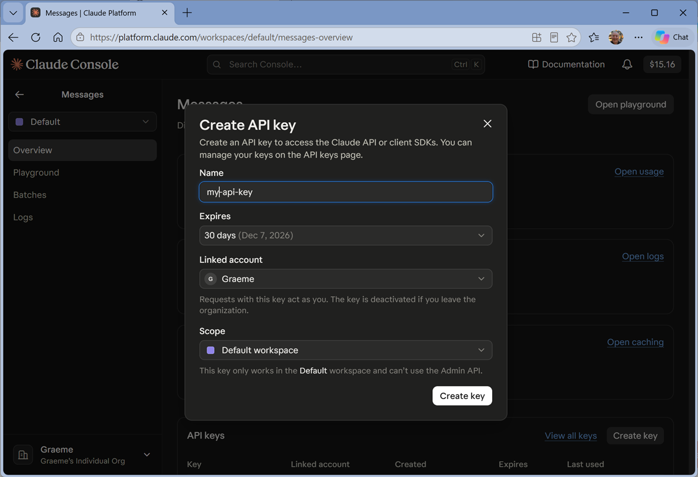
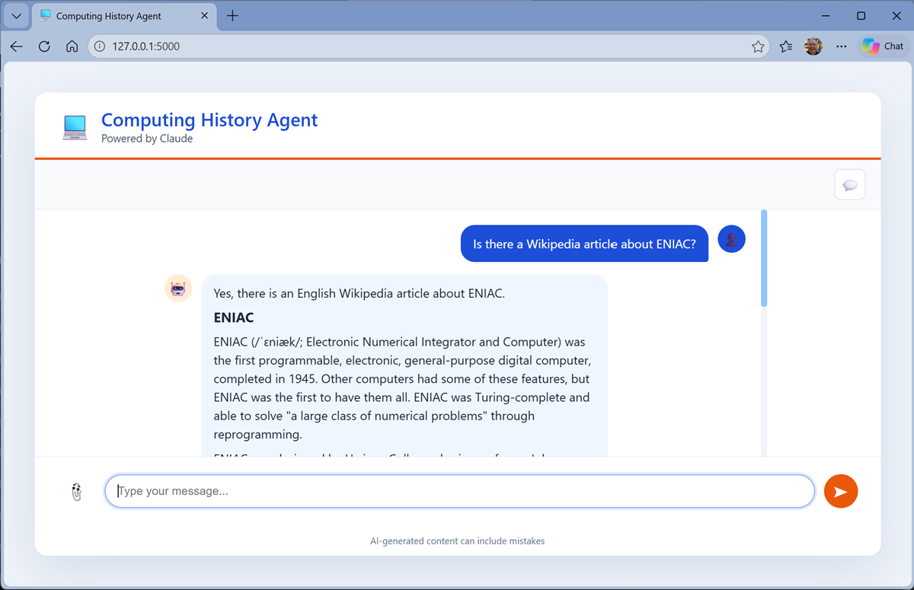

---
lab:
  title: Connect an AI agent to an MCP server
  description: Use the Claude API's MCP connector to give your agent the tools from a remote Wikipedia MCP server, so it can find and display Wikipedia articles.
  level: 200
  duration: 30 minutes
  islab: false
---

# Connect an AI agent to an MCP server

This exercise should take approximately **30** minutes to complete.

> **Note**: Claude Platform, Claude Code, and the Claude models are subject to continual development. This reflects the fast-moving nature of artificial intelligence technology. Some elements of your user experience may differ from the descriptions in this exercise!

In this exercise, you'll extend the computing history agent from the *Extend an AI agent with tools* exercise by connecting it to a *Model Context Protocol* (MCP) server that provides tools for working with Wikipedia. When a user asks for a Wikipedia article about a computing history topic, the agent will use the MCP server's tools to find the most relevant article, and display the article's introduction in the chat, with a link to the full article.

> **Citation**: This exercise uses the [Wikipedia MCP server](https://github.com/cyanheads/wikipedia-mcp-server){:target="_blank"} (`https://github.com/cyanheads/wikipedia-mcp-server`), an open-source project created by **cyanheads** and released under the Apache 2.0 license. The exercise connects to a public instance of the server, hosted by the project's author at `https://wikipedia.caseyjhand.com/mcp`. Thanks to the author for making it available! Article text is from [Wikipedia](https://www.wikipedia.org){:target="_blank"}, and is available under the [Creative Commons Attribution-ShareAlike 4.0](https://creativecommons.org/licenses/by-sa/4.0/){:target="_blank"} license.

## Before you start

Before you start this lab, complete the lab [Get ready for Claude API development](00-get-ready-for-claude-api-development.html). It creates your Claude Console account and installs the tools this lab uses: Visual Studio Code, Git, GitHub, and Python.

This lab continues from the lab [Extend an AI agent with tools](02-use-tools.html). We recommend that you complete that lab first, but you don't have to - the starter files for this lab contain the finished code from that lab.

## Understand MCP

In the previous lab, you wrote a custom tool: you described it to Claude with a name, a description, and an input schema, and you implemented it as a function in your app. That works well for tools that are specific to your app, but many tools are useful to lots of different agents - for example, tools for searching a knowledge base, reading files in cloud storage, or querying a business system.

The **Model Context Protocol** (MCP) is an open standard for sharing tools like these. An *MCP server* publishes a set of tools (and optionally other resources, such as prompts and data), and any *MCP client* - such as an agent, or an AI coding assistant like Claude Code - can connect to the server, discover its tools, and call them. The tool definitions and the code that implements them live on the server, so you don't need to write them yourself.

The Wikipedia MCP server that you'll use in this lab provides tools that include:

| Tool | What it does |
|---|---|
| **wikipedia_search_articles** | Searches Wikipedia for articles that match a query. |
| **wikipedia_get_summary** | Gets a short summary of an article. |
| **wikipedia_get_article** | Gets the text of an article, or of one section of it. Section 0 is the article's introduction (its *lead* section). |
| **wikipedia_get_sections** | Gets an article's table of contents. |
| **wikipedia_get_references** | Gets the references that an article cites. |

There are two ways to use an MCP server with the Claude API:

- Your app can act as the MCP client: it connects to the server, gets the list of tools, passes them to Claude as custom tools, and calls the server when Claude uses one - just like the custom tool in the previous lab.
- For a remote MCP server that's available on the internet, you can use the Claude API's **MCP connector**. You tell Claude which server to connect to, and Anthropic connects to it and calls its tools for you - like the built-in web search tool. You don't need to write any code to call the tools.

In this lab, you'll use the MCP connector.

## Configure the client application

A client application containing the code from the end of the previous lab has been provided. You'll extend this app to connect to the MCP server.

### Open the client app in Visual Studio Code

1. Start Visual Studio Code.
1. If you have already cloned the repo for these labs, open the local folder in Visual Studio Code. If not, open the command palette (*Ctrl+Shift+P* or on the **View** menu, select **Command Palette**) and enter the `Git:clone` command to clone the `https://github.com/GraemeMalcolm/claude-labs` repo to a local folder (it doesn't matter which one); and after the clone operation is complete, open the folder when prompted.

    > **Tip**: If you cloned the repo before this lab was added, open the command palette and use the `Git: Pull` command to get the latest files.

    The folder may open in **Restricted mode**. If so, select the mode and trust the authors to allow full functionality.

1. In the Activity bar on the left edge, view the **Extensions** pane; and if it is not already installed, search for and install the **Python** extension.
1. In the **Command Palette**, use the command `python:select interpreter` to create a new **Venv** environment based on your Python 3.1x installation (or select the one you created previously).

    > **Tip**: You can choose to install the workspace dependencies in the *requirements.txt* file as you create the environment. Don't worry if you accidentally skip this though; we'll do it in a later step anyway.

1. In the Activity bar, switch back to the **Explorer** pane, and navigate to the folder containing the application code files at **/computer-history-mcp-client**. The application files include:
    - **.env** (the application configuration file)
    - **agent_client.py** (the code file for the Python code that implements your agent)
    - **app.py** (the main code file for a Python Flask-based web application)
    - **requirements.txt** (the Python package dependencies that need to be installed)
    - **/static** and **/templates** (the files for the app's web page)
1. In the **Explorer** pane, right-click the **agent_client.py** file, and select **Open in integrated terminal**.

    > **Tip**: Opening the terminal in Visual Studio Code should automatically activate the Python environment after a few seconds. If you're using a PowerShell terminal, you may need to enable running scripts on your system (see [Set-ExecutionPolicy](https://learn.microsoft.com/powershell/module/microsoft.powershell.security/set-executionpolicy){:target="_blank"}). If for any reason the Python environment is not activated automatically, you can use [this query](https://www.bing.com/search?q=%22How%20do%20I%20activate%20a%20Python%20venv%22){:target="_blank"} to search for information on how to activate it in your environment.

1. Ensure that the terminal is open in the **/computer-history-mcp-client** folder with the prefix **(.venv)** to indicate that the Python environment is active.
1. Install the required Python packages by running the following command:

   ```
   pip install -r requirements.txt
   ```

### Configure your API key

1. If you still have the API key that you created in a previous lab, you can use it in this lab. Otherwise, in a web browser, open the [Claude Console](https://platform.claude.com){:target="_blank"} at `https://platform.claude.com`, and on the **Dashboard** page, select **Get API key** to create a new key with an appropraiet name.

    

    Copy the key's value and store it somewhere safe temporarily - you won't be able to view it again after you close the dialog.

1. In Visual Studio Code, in the **Explorer** pane, in the **/computer-history-mcp-client** folder, select the **.env** file to open it. Then replace *your_api_key* with your API key.

    > **Important**: An API key is a secret. Never commit it to source control or share it. Don't commit your edited *.env* file if you push changes to a repo.

1. Save the updated **.env** file.

## Connect the agent to the MCP server

Now you'll add the Wikipedia MCP server to your agent, and update the agent's instructions so that it knows how to use it.

1. In the **Explorer** pane, in the **/computer-history-mcp-client** folder, select the **agent_client.py** file to open it.
1. Review the code. It's the code from the end of the previous lab, with comments marking where you'll add the code for this lab.

    > **Tip**: As you add code to the code file, be sure to maintain the correct indentation.

### Define the MCP server

1. Find the comment **Define the MCP server that provides Wikipedia tools** (after the system prompt), and add the following code under it:

   ```python
   # Define the MCP server that provides Wikipedia tools
   # (Wikipedia MCP server by cyanheads: https://github.com/cyanheads/wikipedia-mcp-server)
   MCP_SERVERS = [
       {"type": "url", "url": "https://wikipedia.caseyjhand.com/mcp", "name": "wikipedia"}
   ]
   ```

    Each MCP server has a **url**, where the server can be reached, and a **name**, which you'll use to refer to it from the list of tools. This server is public, so it doesn't need any credentials. For a server that requires authentication, you can also specify an **authorization_token**.

### Add the MCP server's tools

1. In the **TOOLS** list, find the comment **MCP toolset: Anthropic connects to the MCP server and runs its tools for you** (after the **download_image** tool definition), and add the following code under it:

   ```python
   # MCP toolset: Anthropic connects to the MCP server and runs its tools for you
   {
       "type": "mcp_toolset",
       "mcp_server_name": "wikipedia",
       # Only enable the tools that the agent needs
       "default_config": {"enabled": False},
       "configs": {
           "wikipedia_search_articles": {"enabled": True},
           "wikipedia_get_article": {"enabled": True}
       }
   }
   ```

    An **mcp_toolset** entry gives Claude the tools from the MCP server that has the matching name. Note that:
    - You don't define the tools yourself. Anthropic gets each tool's name, description, and input schema from the server.
    - By default, all of the server's tools are enabled. Here, **default_config** disables them all, and **configs** enables only the two tools that the agent needs, to search for an article and to read its introduction. Giving an agent only the tools it needs makes its behavior more predictable, and reduces the number of tool definitions it has to read with each request.

### Update the agent's instructions

1. Find the **SYSTEM_PROMPT** definition, and replace its last two lines (the line that starts **"After downloading an image**, and the closing parenthesis under it) with the following code, so that the system prompt includes instructions for handling requests for Wikipedia articles:

   ```python
       "After downloading an image, briefly describe what it shows, and credit its author and license. "
       "When the user asks for a Wikipedia article, use the Wikipedia tools to find the most relevant "
       "English Wikipedia article, and get its introduction (section_index 0). "
       "Respond with the article's title as a heading, followed by the introduction text exactly as "
       "returned (leaving out any infobox data lines and notes such as 'For other uses, see...'), "
       "followed by a markdown link to the full article labeled 'Read the full article on Wikipedia', "
       "and finally the note 'Text from Wikipedia, available under the CC BY-SA 4.0 license.'"
   )
   ```

    These instructions tell Claude how to use the MCP server's tools to get an article's introduction, and how to format its response. The app already displays responses as formatted *markdown*, so the article title is shown as a heading, and the link to the full article can be selected. Wikipedia's license requires that you credit Wikipedia when you reuse its text, so the response ends with a note to do so.

### Connect to the MCP server in the request to Claude

1. In the **send_message** function, find the code in the agent loop that calls **self.client.messages.create**, and modify it to match the following code:

   ```python
   response = self.client.beta.messages.create(
       model=self.model,
       max_tokens=16000,
       system=SYSTEM_PROMPT,
       tools=TOOLS,
       mcp_servers=MCP_SERVERS,
       betas=["mcp-client-2026-09-15"],
       messages=messages
   )
   ```

    The changes are:
    - The MCP connector is a *beta* feature, so the code uses **client.beta.messages.create** and specifies the beta feature in the **betas** parameter.
    - The **mcp_servers** parameter tells Claude which MCP servers to connect to.

    > **Note**: Beta features are subject to change. If you get an error about the beta name, check the [MCP connector documentation](https://platform.claude.com/docs/en/agents-and-tools/mcp-connector){:target="_blank"} for the current value.

1. Review the rest of the agent loop. Note that you <u>don't</u> need to change it! Like the web search tool, the MCP server's tools run on Anthropic's side: Claude calls a tool, and the response includes **mcp_tool_use** and **mcp_tool_result** content blocks that show which tools Claude used and what they returned. (The response can also include an **mcp_tool_listing** block, which records the list of tools that the server provided.) Your code only has to run *client-side* tools, like **download_image** - and because the loop sends Claude's responses back unchanged, and only reads the *text* blocks to get the answer, the new block types don't need any extra code.
1. Save the **agent_client.py** file.

> **Important**: When you connect an agent to an MCP server, the server's tool descriptions and results are passed to Claude. Only connect to MCP servers that you trust, and treat the content they return as data, not as instructions. The text of Wikipedia articles is written by the public, so it could include text that tries to change the agent's behavior - enabling only the tools that the agent needs, and keeping the agent's instructions specific, helps to limit the risk.

## Run the client application

Now you're ready to test your agent's new tools.

1. In the terminal, enter the following command to run the application:

   ```powershell
   python app.py
   ```

1. When the Flask application starts, open your browser and navigate to the URL where it is running - for example, [http://127.0.0.1:5000](http://127.0.0.1:5000) (`http://127.0.0.1:5000`).
1. Enter the prompt `Is there a Wikipedia article about ENIAC?`, and wait for the response.

    The agent uses the MCP server's tools to find the article and read its introduction. The response shows the article's title, its introduction, and a link to the full article.

    

1. Select the **Read the full article on Wikipedia** link, and verify that it opens the article in a new browser tab. Then close the tab and return to the app.
1. Try a request that doesn't name the article exactly, such as `Is there a Wikipedia article about the woman who wrote the first computer program?`

    The agent searches Wikipedia to find the most relevant article.

1. Try some more requests, such as:
    - `Get the Wikipedia article on the transistor.`
    - `Show me the Wikipedia article about the Commodore 64.`
1. Try an off-topic request, such as `Can I get the Wikipedia article on pizza?`, and verify that the agent still follows its instructions about the topics it can discuss.
1. Verify that the agent's other features still work. For example, ask `Show me a picture of the Apple I` to test the image download tool from the previous lab, or `Find the latest news for vintage computer enthusiasts.` to test web search.

    Your agent now combines three kinds of tool: a built-in tool (web search), a custom tool that runs in your app (download image), and tools from a remote MCP server (Wikipedia). Claude decides which tools to use for each request.

1. When you've finished testing the app, close the browser, and in Visual Studio Code, enter **CTRL+C** in the terminal pane, to stop the local web server.

## Optional: Use the MCP server with Claude Code

MCP servers aren't just for the agents you build. Any MCP client can use them - including Claude Code. If you have time, connect Claude Code to the same Wikipedia MCP server. If you haven't installed Claude Code yet, see the *Develop your first AI agent with Claude* lab for instructions.

1. In Visual Studio Code, in the **Explorer** pane, create a new file named **.mcp.json** in the root folder of the repo (the folder that contains the **/computer-history-mcp-client** folder), and add the following content to it:

   ```json
   {
     "mcpServers": {
       "wikipedia": {
         "type": "http",
         "url": "https://wikipedia.caseyjhand.com/mcp"
       }
     }
   }
   ```

1. Save the file, and then open Claude Code (or start a new conversation in it). When prompted, approve the **wikipedia** MCP server.

    > **Tip**: You can enter the `/mcp` command in Claude Code to see the MCP servers it's connected to, and their tools.

1. Enter a prompt such as `Use Wikipedia to tell me what the S-100 bus was, and which computers used it.`, and review the response. When Claude Code asks for permission to use a Wikipedia tool, allow it.
1. When you've finished, delete the **.mcp.json** file if you don't want Claude Code to keep using the server in this folder.

## Summary

In this exercise, you connected an agent to a remote MCP server by using the Claude API's MCP connector. You defined the server, added its tools to the agent with an **mcp_toolset** - enabling only the tools the agent needs - and updated the agent's instructions so that it displays the introduction of a relevant Wikipedia article, with a link to the full article. Because Anthropic connects to the server and runs its tools, you didn't need to write any code to implement them or to call them.

## Clean up

If you created an API key for this exercise, you can delete it in the **API keys** page of the Claude Console, so that it can't be used again. If you created a **.mcp.json** file for Claude Code, you can delete it.
