---
lab:
  title: Develop a managed AI agent with Claude
  description: Rebuild the computing history agent as a managed agent - with web search, image input, a custom tool, and an MCP server - and build a client app that chats with it.
  level: 200
  duration: 60 minutes
  islab: false
---

# Develop a managed AI agent with Claude

This exercise should take approximately **60** minutes to complete.

> **Note**: Claude Platform and the Claude models are subject to continual development. This reflects the fast-moving nature of artificial intelligence technology. Some elements of your user experience may differ from the descriptions in this exercise - in particular, Managed Agents is a beta feature, and the layout of its portal pages may change.

In the previous exercises, you built a computing history agent with the Messages API. Your code ran the agent loop, kept the conversation history, and handled each tool: the built-in web search tool, a custom tool that downloads images, and the tools from a Wikipedia MCP server. Users could also include an image with their prompt.

In this exercise, you'll rebuild the same agent as a *managed agent*. Instead of writing an agent loop in your own code, you'll define the agent in the Claude Console and let Anthropic host it and run the loop. Then you'll write a Python client app that starts a session with your agent and chats with it - and you'll extend the agent with the same capabilities as before, to see how each one works when the platform runs the agent.

> **Citation**: This exercise uses the [Wikipedia MCP server](https://github.com/cyanheads/wikipedia-mcp-server){:target="_blank"} (`https://github.com/cyanheads/wikipedia-mcp-server`), an open-source project created by **cyanheads** and released under the Apache 2.0 license. The exercise connects to a public instance of the server, hosted by the project's author at `https://wikipedia.caseyjhand.com/mcp`. Article text is from [Wikipedia](https://www.wikipedia.org){:target="_blank"}, and is available under the [Creative Commons Attribution-ShareAlike 4.0](https://creativecommons.org/licenses/by-sa/4.0/){:target="_blank"} license.

## Before you start

Before you start this lab, complete the lab [Get ready for Claude API development](00-get-ready-for-claude-api-development.html). It creates your Claude Console account and installs the tools this lab uses: Visual Studio Code, Git, GitHub, and Python. If you haven't done that yet, complete it first.

This lab recreates the agent that you built in the labs [Develop your first AI agent with Claude](01-create-first-claude-agent.html), [Extend an AI agent with tools](02-use-tools.html), and [Connect an AI agent to an MCP server](03-use-mcp.html). We recommend that you complete those labs first, so that you can compare the two approaches - but you don't have to.

## Understand managed agents

When you build an agent with the Messages API, your code owns the agent loop, the conversation history, and the place where tools run. With **Managed Agents**, those responsibilities move to the platform:

- An **agent** is a saved, versioned definition of a model, instructions (system prompt), and tools.
- An **environment** is a template for the cloud container in which the agent's tools run.
- A **session** is a running instance of an agent in an environment. The session keeps the conversation state, and runs the agent loop on Anthropic's infrastructure.
- Your client app sends **events** (such as a user message) to the session, and receives a stream of events (such as the agent's response) back.

Here's how the features of the agent you built in the previous labs map to a managed agent:

| Feature | Messages API (previous labs) | Managed agent (this lab) |
|---|---|---|
| Model, instructions, and tools | Defined in your code, and sent with every request | Defined once, in the agent - your client code doesn't include them |
| Agent loop | Your code calls Claude repeatedly until it finishes | Anthropic runs the loop in the session |
| Conversation history | Your code keeps it, and sends it with every request | The session keeps it |
| Web search | A built-in tool that Anthropic runs | A built-in tool that Anthropic runs |
| Image input | An *image* content block in the user message | An *image* content block in the **user.message** event |
| Custom tool (download image) | Your code runs it when the response has the **tool_use** stop reason | Your code runs it when the session sends an **agent.custom_tool_use** event |
| MCP server (Wikipedia) | Declared in each request, with the MCP connector | Declared once, in the agent |

> **Note**: Using the Claude API requires an Anthropic Console account with API credits. Usage in this exercise is light, but if your account has no credits, you'll be prompted to add some before you can run sessions.

## Create a managed agent in the Claude Console

1. In a web browser, open the [Claude Console](https://platform.claude.com){:target="_blank"} at `https://platform.claude.com`, and sign in. If prompted, complete any setup steps - including adding credits to your account.

    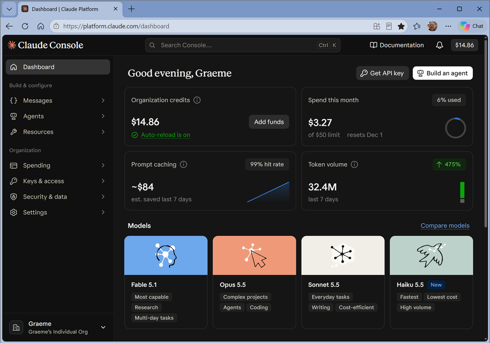

### Create the agent

1. In the navigation menu, in the **Agents** section, open the **Create** page.

    A list of agent templates is shown.

    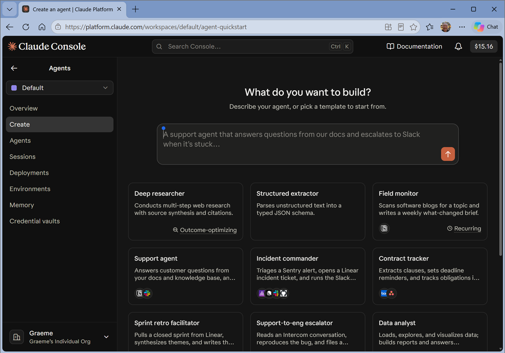

1. Under the list of templates, select **start from a blank agent**. This starts a multi-step wizard to help you walk through the steps of creating a managed agent.
1. In the first step, enter the following description for the agent:

    ```
    A computing history agent that helps users with questions about key people, events, and technologies in the history of computing.
    ```

1. Review the agent configuration that is created, and then go ahead and create the agent.
1. Create a new environment for the agent, with unrestricted networking.
1. Start a test session and test the agent with a suitable question, such as `Who was Grace Hopper, and why was her work on compilers so important?`.

    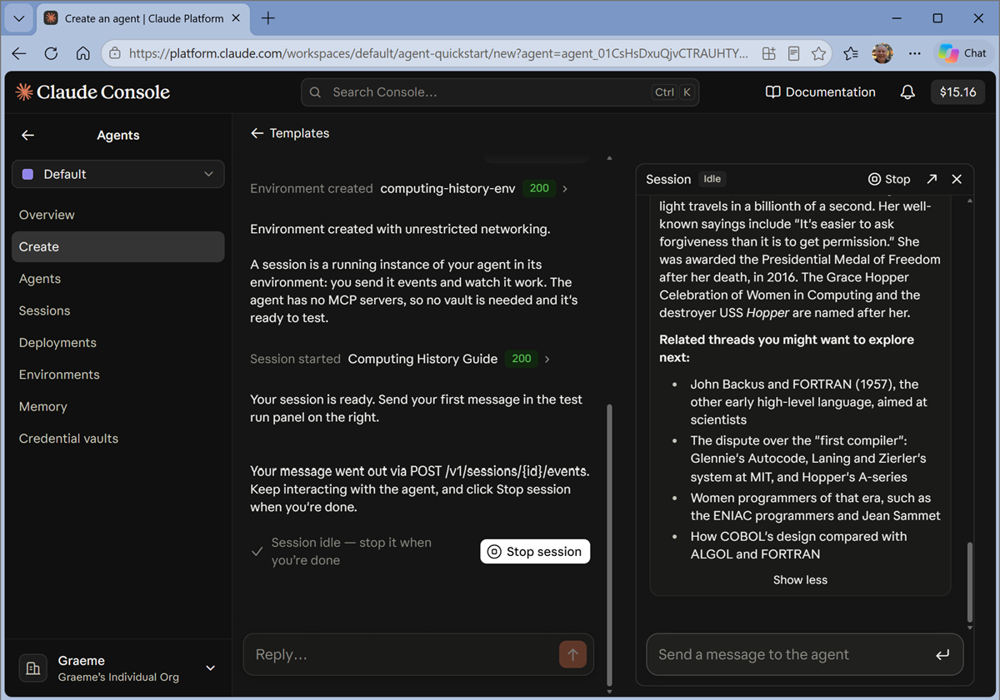

1. Stop the test session and specify that you want to call the agent from an application. Then exit the agent creation wizard. Your completed agent is opened in its own page.

    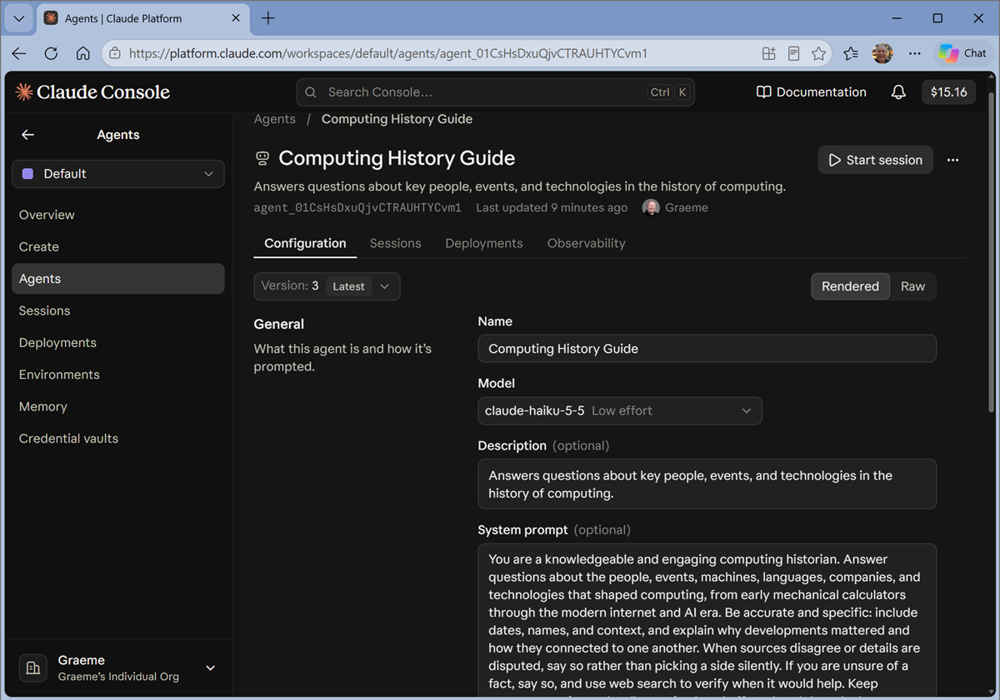

### Configure the agent

1. In the page for your agent, select the model **Claude Haiku 5.5** (`claude-haiku-5-5`) and review the **System prompt**, modifying it if desired. As a minimum, it should provide guidance to the agent similar to this:

   ```
   You are an expert in the history of computing and AI. You only answer questions about significant people and events in the development of computing, and about notable vintage computers. Do not engage in conversations on any topic that is unrelated to computing history.
   ```

1. In the agent's tools configuration, set the **web_fetch** and **web_search** tool permissions to **Always allow**, and set the **Always deny** permission for all the other built-in tools (such as bash, and file read/write/edit) - your agent only needs to search and retrieve information from the web.

    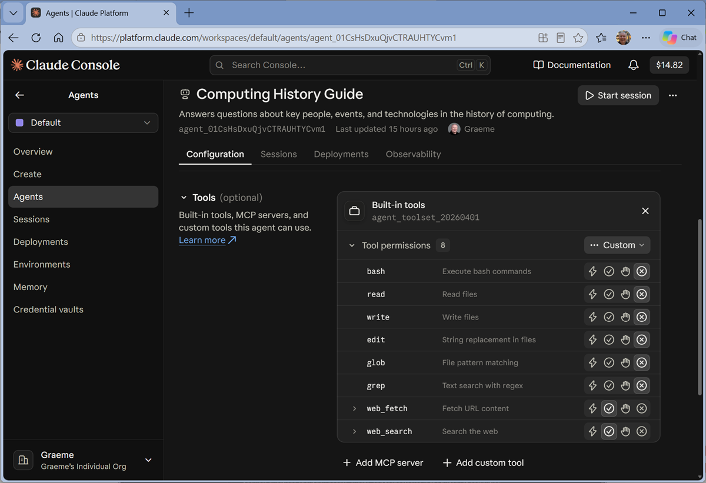

    > **Note**: The agent toolset includes *server-hosted* tools such as bash and file operations that run in the session's container. You've turned off the ones this agent doesn't need - it's good practice to give an agent only the tools it needs.

1. Save a new version of the agent with your changes.
1. Start a new session named `Test run` in the environment that was created by the wizard, and test the updated agent with a suitable prompt (such as `Tell me about Alan Turing.`).

    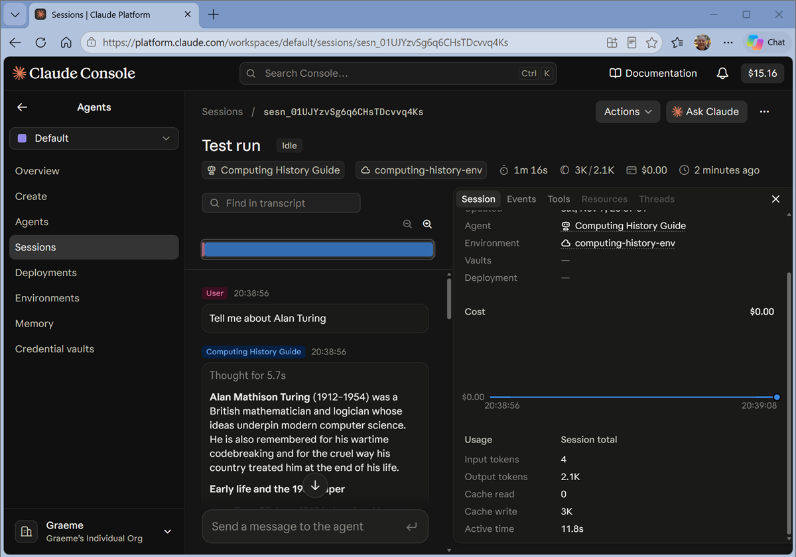

    > **Tip**: The session transcript shows every event in the session - including each tool call and its result, along with token usage. It's a useful way to see what the agent did and why.

### View agents and environments

1. View the **Agents** page, where your agent (and any others you've created) is listed. Note the **agent ID** (it looks like `agent_...`). You'll need this later.
1. View the **Environments** page and find the cloud environment created for your agent.

    > **Note**: Unrestricted networking is fine for this learning exercise because the agent has no access to sensitive files or secrets. For a production agent, use *limited* networking and list only the hosts the agent needs.

1. Note the **environment ID** (it looks like `env_...`). You'll also need this later.

### Create an API key

To call your agent from code, you need an API key.

1. In the Claude Console, in the navigation menu, return to the top-level **Dashboard** page and select **Get API key**.

    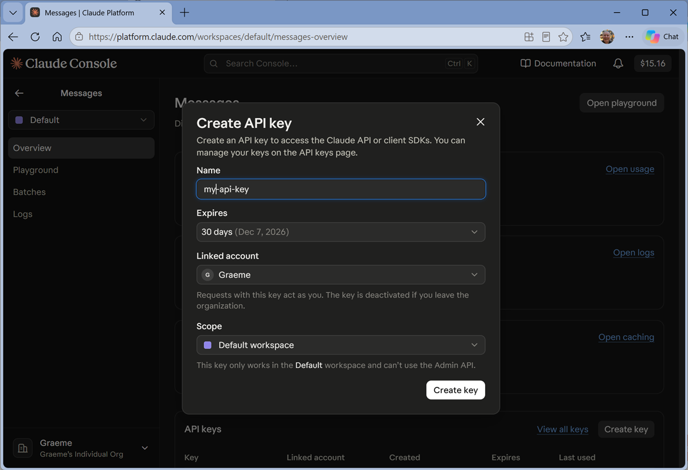

1. Create a new key named `computing-historian-agent-client`, and copy its value. Store it somewhere safe temporarily - you won't be able to view it again after you close the dialog.

## Create a client app for the agent

Now you'll write Python code that starts a session with your managed agent and uses it in a web-based chat application.

### Configure a client application in Visual Studio Code

A partially completed client application has been provided. It includes the same web interface as the app in the previous labs - including the ability to attach an image to a prompt, and to display images that the agent downloads. You'll complete the code that connects to your agent.

1. Start Visual Studio Code.

    > **Tip**: If you're new to Visual Studio Code, you can refer to the [documentation](https://code.visualstudio.com/Docs){:target="_blank"} at `https://code.visualstudio.com/Docs` for help.

1. If you haven't already cloned the repo, open the command palette (*Ctrl+Shift+P* or on the **View** menu, select **Command Palette**) and enter the `Git:clone` command to clone the `https://github.com/GraemeMalcolm/claude-labs` repo to a local folder (it doesn't matter which one). Then open the folder when prompted.

    > **Tip**: If you cloned the repo before this lab was updated, open the command palette and use the `Git: Pull` command to get the latest files.

    The folder may open in **Restricted mode**. If so, select the mode and trust the authors to allow full functionality.

    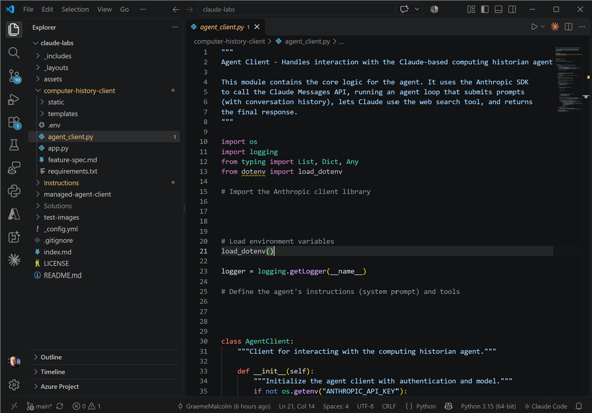

1. In the Activity bar on the left edge, view the **Extensions** pane; and if it is not already installed, search for and install the **Python** extension.
1. In the **Command Palette**, use the command `python:select interpreter` to create a new **Venv** environment based on your Python 3.1x installation (or select the one you created previously).

    > **Tip**: You can choose to install the workspace dependencies in the *requirements.txt* file as you create the environment. Don't worry if you accidentally skip this though; we'll do it in a later step anyway.

1. In the **Explorer** pane, navigate to the folder containing the application code files at **/managed-agent-client**. The application files include:
    - **.env** (the application configuration file)
    - **agent_client.py** (the code file for the Python code that connects to your agent)
    - **app.py** (the main code file for a Python Flask-based web application)
    - **image_tools.py** (the code for downloading images, which you'll use later)
    - **update_agent.py** (a script that updates the agent's configuration, which you can use later)
    - **requirements.txt** (the Python package dependencies that need to be installed)
    - **/static** and **/templates** (the files for the app's web page)
1. In the **Explorer** pane, right-click the **agent_client.py** file, and select **Open in integrated terminal**.

    > **Tip**: Opening the terminal in Visual Studio Code should automatically activate the Python environment after a few seconds. If you're using a PowerShell terminal, you may need to enable running scripts on your system (see [Set-ExecutionPolicy](https://learn.microsoft.com/powershell/module/microsoft.powershell.security/set-executionpolicy){:target="_blank"}). If for any reason the Python environment is not activated automatically, you can use [this query](https://www.bing.com/search?q=%22How%20do%20I%20activate%20a%20Python%20venv%22){:target="_blank"} to search for information on how to activate it in your environment.

1. Ensure that the terminal is open in the **/managed-agent-client** folder with the prefix **(.venv)** to indicate that the Python environment is active.

    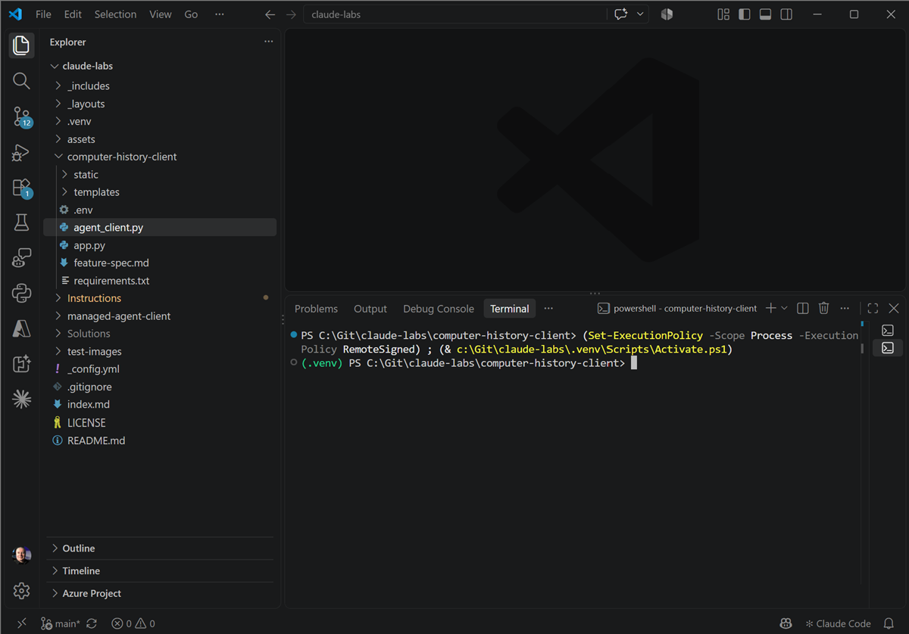

    > **Tip**: You can resize the terminal pane.

1. Install the required Python packages by running the following command:

   ```
   pip install -r requirements.txt
   ```

1. In the **Explorer** pane, in the **/managed-agent-client** folder, select the **.env** file to open it. Then replace the placeholder values:
    - *your_api_key* with the API key you created in the Claude Console.
    - *your_agent_id* with the ID of your agent.
    - *your_environment_id* with the ID of your agent's environment.

    > **Important**: An API key is a secret. Never commit it to source control or share it. In this exercise it's stored in a local *.env* file that your code loads at runtime - don't commit your edited *.env* file if you push changes to a repo.

1. Save the updated **.env** file.

### Add code to connect to the agent

Notice that this client doesn't contain the model name, the system prompt, or the tool definitions - they're all part of the agent you defined in the Console. The client only needs to start a session and exchange events with it.

1. In the **Explorer** pane, in the **/managed-agent-client** folder, select the **agent_client.py** file (<u>not</u> *app.py*) to open it.

    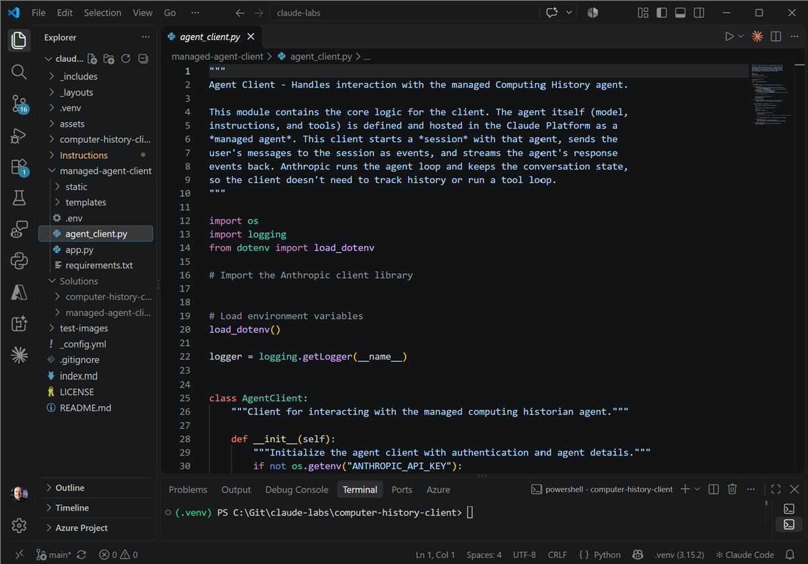

1. Review the existing code. You will add code that uses the Anthropic SDK to work with your agent.

    > **Tip**: As you add code to the code file, be sure to maintain the correct indentation.

1. Find the comment **Import the Anthropic client library**, and add the following code to import the SDK:

   ```python
   # Import the Anthropic client library
   from anthropic import Anthropic
   ```

1. In the **AgentClient** class, in the **\_\_init\_\_** function, note that code has been provided to load the API key, agent ID, and environment ID from the configuration file. Then find the comment **Create the Anthropic client** and add the following code:

   ```python
   # Create the Anthropic client
   self.client = Anthropic()
   ```

    The client automatically reads the **ANTHROPIC_API_KEY** environment variable (which was loaded from your *.env* file).

1. In the **\_start_session** function, find the comment **Create a session that uses the managed agent and environment** and add the following code:

   ```python
   # Create a session that uses the managed agent and environment
   session = self.client.beta.sessions.create(
       agent=self.agent_id,
       environment_id=self.environment_id,
   )
   self.session_id = session.id
   ```

    The session is the running instance of your agent. Because the session stores the conversation, the client app doesn't need to keep a history of messages - it just needs to remember the session ID. Passing the agent ID as a string uses the latest version of the agent.

1. In the **send_message** function, find the comment **Build the content of the user's message: an optional image, followed by the text** and add the following code:

   ```python
   # Build the content of the user's message: an optional image, followed by the text
   content: List[Dict[str, Any]] = []
   if image:
       content.append({
           "type": "image",
           "source": {
               "type": "base64",
               "media_type": image["media_type"],
               "data": image["data"],
           },
       })
   content.append({"type": "text", "text": user_message})
   ```

    Just like a message in the Messages API, a user message for a managed agent is a list of *content blocks*. If the user attached an image, the message includes an **image** block (containing the base64-encoded image data and its media type), followed by a **text** block containing the prompt.

1. Find the comment **Stream events from the session, send the user's message, and collect the response** and add the following code:

   ```python
   # Stream events from the session, send the user's message, and collect the response
   with self.client.beta.sessions.events.stream(session_id=self.session_id) as stream:
       # Send the user's message to the session as an event
       self.client.beta.sessions.events.send(
           session_id=self.session_id,
           events=[{"type": "user.message", "content": content}],
       )

       # Process the events the agent sends back
       for event in stream:
           if event.type == "agent.message":
               # The agent's reply is made up of text blocks
               for block in event.content:
                   if block.type == "text":
                       assistant_message += block.text
           elif event.type == "session.status_idle":
               if event.stop_reason.type == "requires_action":
                   # The agent is waiting for something that this app doesn't provide
                   assistant_message += "\n\nThe agent is waiting for a tool result or approval that this app doesn't provide. Reset the conversation to continue."
               # The agent has finished its turn
               break
           elif event.type == "session.status_terminated":
               assistant_message += "\n\nThe session ended unexpectedly."
               break
   ```

    This code is the heart of the client. The stream is opened *before* the message is sent, so that no events are missed. The agent loop - deciding whether to search the web, running the searches, and composing the answer - all happens on the platform. Your code just watches the stream of events: **agent.message** events contain the response text, and a **session.status_idle** event signals that the agent has stopped. Usually, that means it has finished and is waiting for the next message; but if the stop reason is **requires_action**, the agent is waiting for the app to do something first - you'll see an example of that later.

1. Check the line after the code you just added: `return assistant_message.strip() or "The agent didn't return a response."`. It must be indented at the same level as the **with** statement, not inside the event loop.

    > **Tip**: When you paste a block of code, the line after it can be indented to match the pasted code. If the **return** line ends up inside the event loop, the **send_message** function doesn't return a response, and the app shows an error such as `'NoneType' object has no attribute 'strip'`.

1. Read through the rest of the code, noting how **reset_conversation** starts a new session to clear the conversation.
1. Save the updated **agent_client.py** file.

### Run the client application

Now you're ready to test the app.

1. In the terminal, enter the following command to run the application:

   ```powershell
   python app.py
   ```

1. When the Flask application starts, open your browser and navigate to the URL where it is running - for example, [http://127.0.0.1:5000](http://127.0.0.1:5000) (`http://127.0.0.1:5000`).

    > **Tip**: If the app displays an error that the agent client isn't initialized, check that your API key, agent ID, and environment ID are correctly set in the *.env* file, and that you saved the file.

    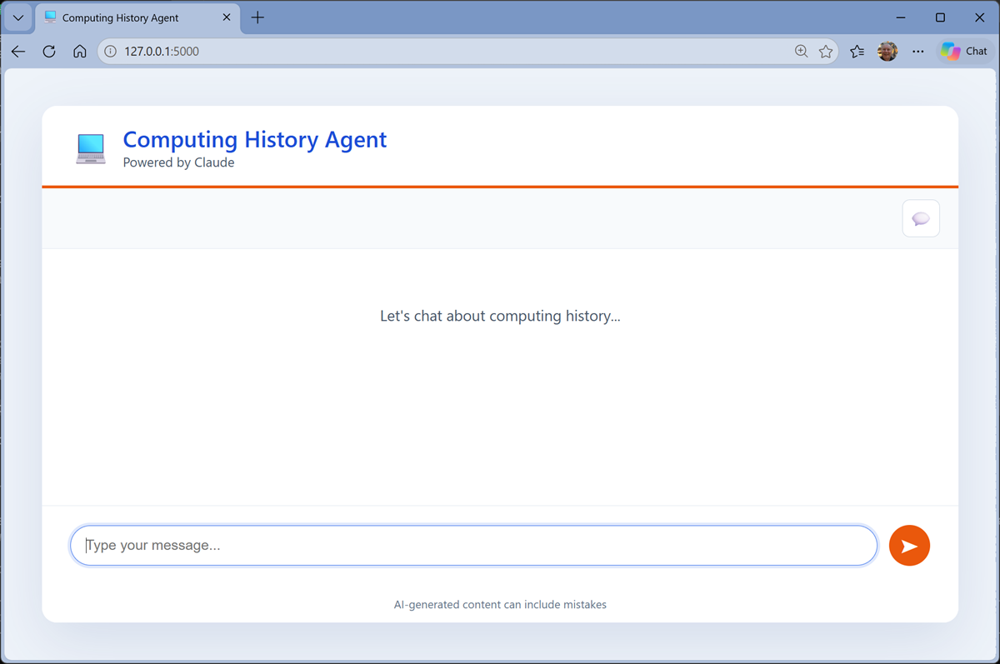

1. Enter a prompt, such as `What was ENIAC?` and view the response.

    The first response may take a little longer, as the session's container is provisioned.

1. Follow up with a second prompt, such as `How does it compare with COLOSSUS?`
1. Try an off-topic prompt, like `What's a good recipe for pancakes?`, to verify that the agent follows its instructions.
1. Use the attach button to upload one of the images from the **/test-images** folder (which is in the folder where you cloned the repo), and enter the prompt `What can you tell me about this?`. The agent should identify the computer in the image.
1. Select the **reset** button in the app to start a new conversation, and then ask `How does it compare with COLOSSUS?` again. Because this is a new session, the agent doesn't know what "it" refers to.
1. When you've finished testing the app, close the browser, and in Visual Studio Code, enter **CTRL+C** in the terminal pane, to stop the local web server.

### View the sessions in the Console

1. Return to the Claude Console and in the **Agents** section, on the **Sessions** page, view the sessions for your agent.
1. Open the sessions created by your client app, and review the transcript of events - including the user messages, agent responses, and web search tool calls.

    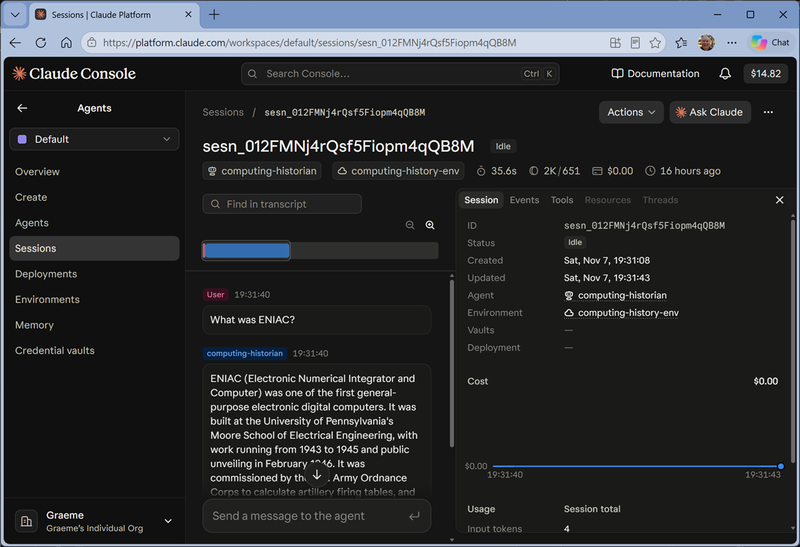

## Add tools to the agent

Your managed agent can now do everything that the agent in the first lab could do. Next, you'll give it the tools from the previous two labs: the **download_image** custom tool, and the tools from the Wikipedia MCP server. Because the tools are part of the agent's definition, you'll add them to the agent - not to your client code.

> **Note**: The layout of the agent editor in the Claude Console may differ from these descriptions. If you can't find a setting, look for it in the agent's tools configuration - or use the optional script described at the end of this section, which applies the same configuration with code.

### Update the agent in the Console

1. In the Claude Console, in the **Agents** section, open your computing historian agent.
1. Replace the agent's **System prompt** with the following instructions, which add guidance for requests for images and for Wikipedia articles (the same instructions that you used in the previous labs):

   ```
   You are an expert in the history of computing and AI. You only answer questions about significant people and events in the development of computing, and about notable vintage computers. Do not engage in conversations on any topic that is unrelated to computing history. When the user asks to see an image of a historic computer, hardware component, or person, use web search to find a relevant image that is in the public domain or released under a Creative Commons license (Wikimedia Commons is a good source). Then use the download_image tool to save the image for the user. Never download an image unless the search results show that its license permits reuse. After downloading an image, briefly describe what it shows, and credit its author and license. When the user asks for a Wikipedia article, use the Wikipedia tools to find the most relevant English Wikipedia article, and get its introduction (section_index 0). Respond with the article's title as a heading, followed by the introduction text exactly as returned (leaving out any infobox data lines and notes such as 'For other uses, see...'), followed by a markdown link to the full article labeled 'Read the full article on Wikipedia', and finally the note 'Text from Wikipedia, available under the CC BY-SA 4.0 license.'
   ```

1. In the agent's tools configuration, add a **custom tool** with the following settings:
    - **Name**: `download_image`
    - **Description**:

        ```
        Downloads an openly licensed image from the web and saves it in the client app's downloads folder, so that it can be displayed to the user. Only use this tool for images that are in the public domain or released under a Creative Commons license. Images must be JPEG, PNG, GIF, or WebP files of up to 5 MB. Returns the saved file's details as JSON, or an error message if the image can't be downloaded.
        ```

    - **Input schema**:

        ```json
        {
          "type": "object",
          "properties": {
            "image_url": {
              "type": "string",
              "description": "The URL of the image's web page (for example, a Wikimedia Commons file page such as https://commons.wikimedia.org/wiki/File:Example.jpg), or the URL of the image file."
            },
            "title": {
              "type": "string",
              "description": "A short title describing the image (for example, 'Altair 8800 computer')."
            },
            "author": {
              "type": "string",
              "description": "The author or creator of the image, as stated on its source page."
            },
            "license": {
              "type": "string",
              "description": "The image's license (for example, 'CC BY-SA 4.0' or 'Public domain')."
            },
            "source_page_url": {
              "type": "string",
              "description": "The URL of the web page where the image and its license are described."
            }
          },
          "required": ["image_url", "title", "author", "license", "source_page_url"]
        }
        ```

    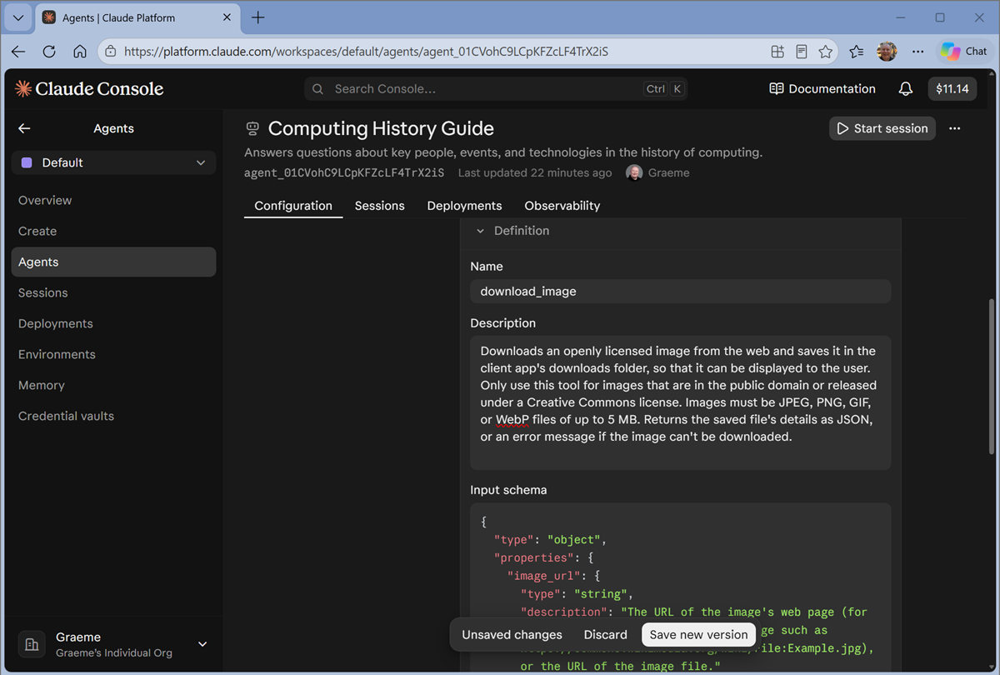

    This is the same tool definition that you used in the *Extend an AI agent with tools* lab. The platform can't run a custom tool - your client app will run it.

1. Add a custom **MCP server** to the agent, specifying the URL `https://wikipedia.caseyjhand.com/mcp`.

    > **Note**: The MCP server does not require authentication. Don't connect to it in the Console, as you'll be prompted to credentials.

1. In the tool settings for the MCP server, set the **Tool permissions* to **Always allow**..

    > **Note**: By default, the permission policy for MCP tools is *Always ask*, which means the session pauses for approval each time the agent wants to use one. These two tools only read public Wikipedia content, and this app doesn't provide a way to approve tool calls, so it's reasonable to allow them. For tools that change data or access private information, keep the *Always ask* policy, and add code to your app to ask the user for approval.

    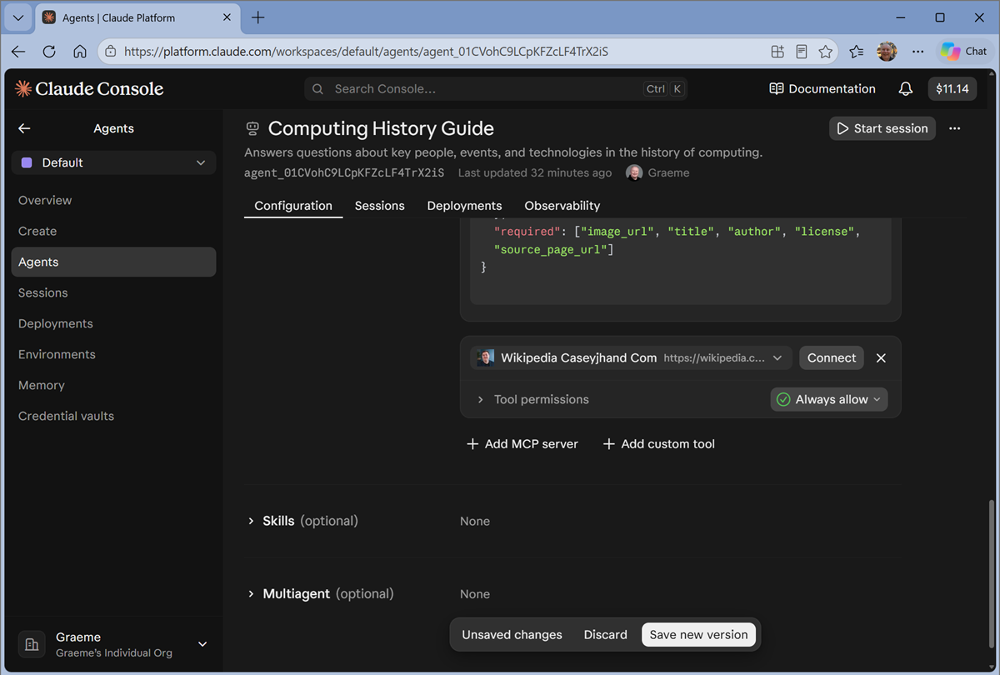

1. Save the changes to create a new version of the agent.


> ### Optional: Update the agent with code
> Instead of using the Console, you can manage an agent's configuration with code - which makes it easy to keep the configuration in source control, and to apply the same configuration to multiple agents. If you want to apply the configuration with the script, run the command `python update_agent.py` in the terminal:

## Handle custom tool calls in the client

When the agent wants to use a custom tool, the session sends an **agent.custom_tool_use** event that contains the tool's name and input, and then goes *idle* with the **requires_action** stop reason. Your app runs the tool, and sends the result back in a **user.custom_tool_result** event - and then the agent carries on.

1. In Visual Studio Code, in the **/managed-agent-client** folder, open the **image_tools.py** file and review its code. It contains the **download_image** function - the same code that you used to implement the custom tool in the *Extend an AI agent with tools* lab.
1. Switch back to the **agent_client.py** file, and find the comment **Run a custom tool that the agent requested** (at the end of the file). Add the following code under it, at the same level of indentation as the comment:

   ```python
   # Run a custom tool that the agent requested
   def run_tool(self, name: str, tool_input: Dict[str, Any]) -> Tuple[str, bool]:
       """Run a custom tool, and return its result as text, and whether it failed."""
       try:
           if name == "download_image":
               image = download_image(**tool_input)
               self.downloaded_images.append(image)
               return json.dumps(image), False
           raise ValueError(f"Unknown tool: {name}")

       except Exception as e:
           # Tell the agent the tool failed, so it can try something else (such as a different image)
           logger.warning("Tool %s failed: %s", name, e)
           return f"Error: {e}", True
   ```

    This function calls the function for the requested tool, and returns its result as text, along with a flag that indicates whether the tool failed. It also adds the details of each downloaded image to the **downloaded_images** list, which the web app uses to display the images.

1. In the **send_message** function, replace the whole **with** block that you added earlier (from the line that starts **with self.client.beta.sessions.events.stream** to the end of the event loop) with the following code:

   ```python
   # Stream events from the session, send the user's message, and collect the response
   with self.client.beta.sessions.events.stream(session_id=self.session_id) as stream:
       # Send the user's message to the session as an event
       self.client.beta.sessions.events.send(
           session_id=self.session_id,
           events=[{"type": "user.message", "content": content}],
       )

       # Track the custom tool calls that this app has answered
       answered_tool_calls = set()

       # Process the events the agent sends back
       for event in stream:
           if event.type == "agent.message":
               # The agent's reply is made up of text blocks
               for block in event.content:
                   if block.type == "text":
                       assistant_message += block.text
           elif event.type == "agent.custom_tool_use":
               # The agent wants to use a custom tool: run it here, and send the result back
               result, is_error = self.run_tool(event.name, event.input)
               self.client.beta.sessions.events.send(
                   session_id=self.session_id,
                   events=[{
                       "type": "user.custom_tool_result",
                       "custom_tool_use_id": event.id,
                       "content": [{"type": "text", "text": result}],
                       "is_error": is_error,
                   }],
               )
               answered_tool_calls.add(event.id)
           elif event.type == "session.status_idle":
               if event.stop_reason.type == "requires_action":
                   if set(event.stop_reason.event_ids) <= answered_tool_calls:
                       # The agent is waiting for tool results that this app has sent - keep going
                       continue
                   # The agent is waiting for something that this app doesn't provide
                   assistant_message += "\n\nThe agent is waiting for a tool result or approval that this app doesn't provide. Reset the conversation to continue."
               # The agent has finished its turn
               break
           elif event.type == "session.status_terminated":
               assistant_message += "\n\nThe session ended unexpectedly."
               break
   ```

    Review the changes:
    - When an **agent.custom_tool_use** event arrives, the code runs the tool, and sends the result back to the session in a **user.custom_tool_result** event. The **custom_tool_use_id** links the result to the request, and **is_error** tells the agent whether the tool failed.
    - When the session goes idle with the **requires_action** stop reason, the **event_ids** in the stop reason identify the events that the agent is waiting on. If the app has already answered all of them, the code keeps reading the stream, because the agent will carry on as soon as it receives the results. Otherwise, the agent is waiting for something the app can't provide (such as approval for a tool), so the code stops and tells the user.

    Compare this with the agent loop that you wrote in the *Extend an AI agent with tools* lab. There, your code called Claude, checked for the **tool_use** stop reason, ran the tool, and called Claude again with the result. Here, the session runs the loop, and your code only responds to the events that need it.

## Test the updated agent

The client app always starts sessions with the latest version of the agent, so you can test some of the new capabilities without changing your code.

1. In Visual Studio Code, re-run the app (`python app.py`), and open it in the browser.
1. Enter the prompt `Show me a picture of a ZX Spectrum`.

    The agent uses your custom tool to download and display an appropriate image.

    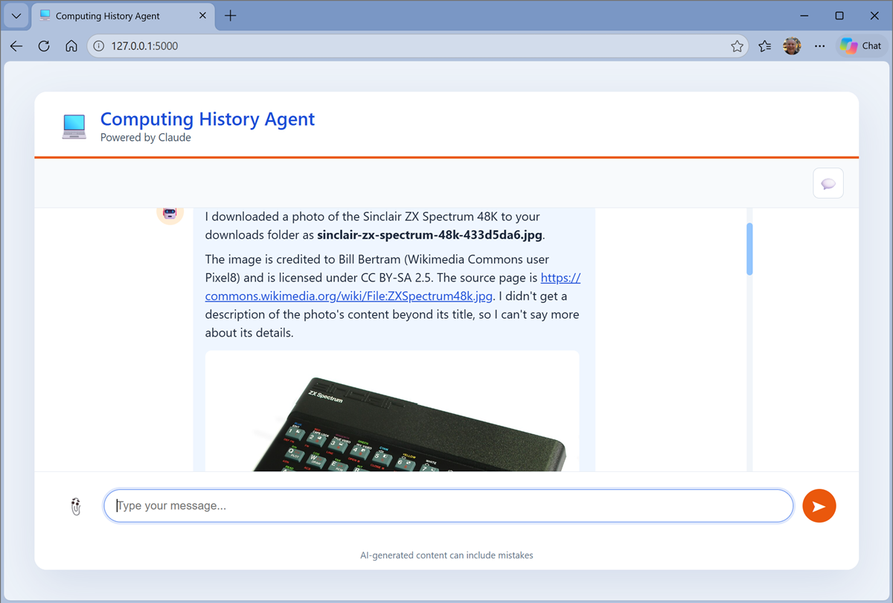

1. Enter the prompt `Is there a Wikiedia article about it?`.

    The agent uses the MCP server you added to find a relevant Wikipedia article.

    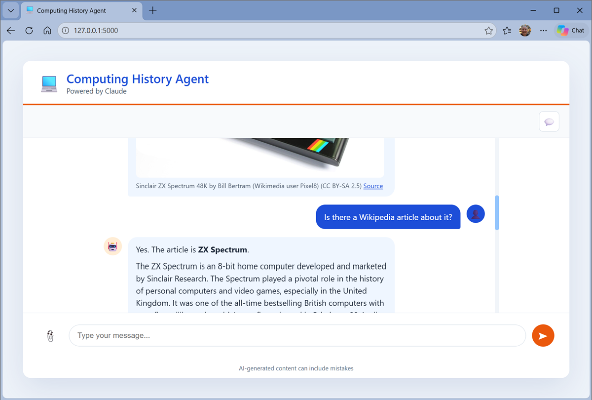

1. Continue experimenting with the agent. When you're finished, close the browser and stop the app in the Visual Studio Code interactive terminal (**CTRL+C**).

1. In the Claude Console, view the sessions for your agent, and open the most recent one. In the transcript, find the events for a web search, an MCP tool call, and a custom tool call - including the **user.custom_tool_result** event that your app sent.

## Summary

In this exercise, you rebuilt the computing history agent as a managed agent. You defined the agent in the Claude Console - with a model, instructions, web search, a custom tool, and an MCP server - and built a Python client app that starts sessions with the agent, sends messages that can include images, streams the agent's responses, and runs the custom tool when the agent asks for it. You saw how a managed agent differs from an agent you implement yourself with the Messages API: the platform hosts the agent, runs the agent loop, keeps the conversation state, and runs the built-in and MCP tools - so your client code only has to handle the tools that must run in your app.

## Clean up

If you no longer need the resources you created for this exercise, you can delete the API key in the **API keys** page of the Claude Console, so that it can't be used again. You can also archive the agent and the environment in the Console - note that archiving can't be undone. You can also delete the **/downloads** folder in the **/managed-agent-client** folder to remove the images that the agent downloaded.
