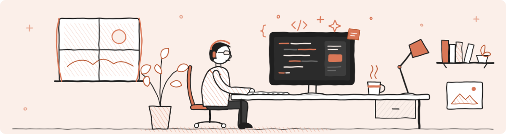

# Claude Labs



> **Tip**: Each lab page includes an **Ask Claude** button that opens a chat assistant to help you with the lab. To use it, you need your own Claude API key (from the Claude Console). The key is stored only in your browser tab and is cleared when you close the tab, and usage is billed to your Console account.


<ul class="lab-list">

  <li>
    <a href="{{ doc.url | remove_first: '/' }}">{{ doc.lab.title | default: doc.name }}</a>
    
{{ doc.lab.description }}

  </li>

</ul>
